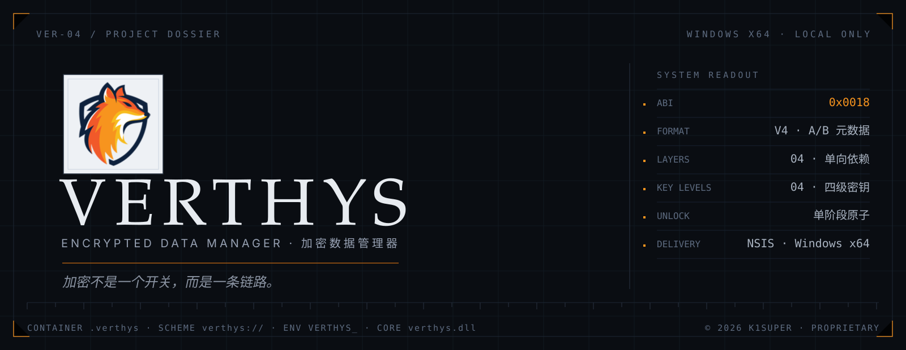
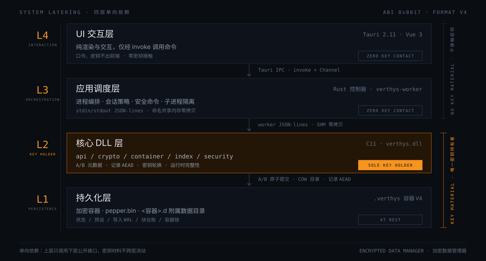
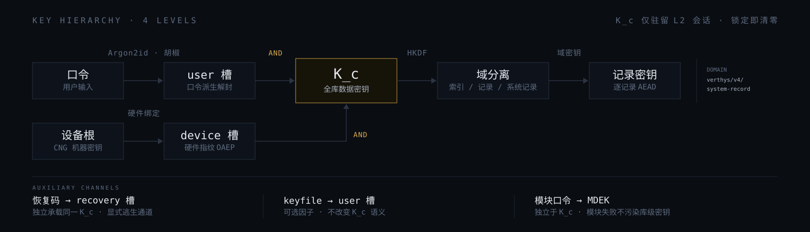

<div align="center">
  
  <br>
  <i>ABI 0x0019&nbsp;·&nbsp;CONTAINER V4&nbsp;·&nbsp;WINDOWS X64&nbsp;·&nbsp;LOCAL ONLY</i>
</div>

<br>

> **加密不是一个开关，而是一条链路**
>
> 上层看不见密钥，下层不信任上层

## 00 · 摘要

Verthys 是一个面向 Windows 的加密数据管理器。敏感数据被封装进加密容器 `.verthys`，由 C 编写的安全核心 `verthys.dll` 承担从密钥守卫、安全解锁，到运行时完整性校验与窃密防护的全部职责。

项目坚持一条边界：**密钥只存在于核心 DLL 层**。UI 与调度层从设计上就不接触任何密钥材料——这不是使用约定，而是分层约束。

| 边界 | 原则 | 结果 |
| --- | --- | --- |
| 密钥 | 只驻留 L2 | 上层零接触 |
| 格式 | 只认当前版本 | 无迁移分支 |
| 失败 | fail-closed | 不静默降级 |
| 交付 | 本地单机 | 无云依赖 |

## 01 · 系统分层



四层单向依赖，上层不接触密钥，下层不信任上层。Tauri 前端只 `invoke` 命令；Rust 控制器把全部 FFI 下沉到独立子进程 `verthys-worker`，二者以 stdin/stdout JSON 行协议通信，扫描结果经命名共享内存零拷贝传输。密钥与明文仅存在于 L2 及其下的 CNG 内核托管。

| 层 | 职责 | 密钥 |
| --- | --- | --- |
| **L4 交互层** | Tauri + Vue 3，纯渲染，口令与密钥不出前端 | 零接触 |
| **L3 调度层** | Rust 控制器 + `verthys-worker` 子进程，进程编排 / 会话策略 / 安全命令 | 零接触 |
| **L2 核心层** | C11 `verthys.dll`，api / crypto / container / index / security | 唯一持有 |
| **L1 持久化层** | `.verthys` 容器、`pepper.bin`、附属数据目录 `<容器>.d` | 仅密文 |

## 02 · 容器格式

一个 `.verthys` 容器就是一套自洽的小型存储引擎：

| 区段 | 设计 |
| --- | --- |
| `HEADER` | `VRTY` 固定头 + A/B 元数据双副本；单副本损坏不阻断打开 |
| `DATA` | 追加数据区 + COW 目录树 + DataRoot 快照；提交按代际原子切换 |
| `RECORD` | 记录段 AEAD 加密 + 名称/类型盲索引 + 墓碑删除；单条记录独立密钥 |
| `MODULE` | 口令 + 设备根双包裹 AND；恢复码 + keyfile 因子；模块 MDEK 独立槽 |
| `COMPAT` | 只认当前格式；异种 magic/版本 fail-closed，不提供旧格式迁移 |

> 崩溃不是异常，是它要处理的常态。

## 03 · 密钥体系



- **胡椒三源** — 注入 / OS 托管 / 编译内嵌，按优先级降级；恢复卡走 Shamir 分片备份。
- **机器绑定** — CNG 机器密钥硬件绑定（machine key / system32 加载器），防克隆迁移。
- **密钥轮换** — 全库 DEK 重建 + 原子替换；轮换期间源库只读，旧库备份保留。
- **解锁原子性** — 密钥校验、元数据提交与仓库挂载全部成功后才进入 UNLOCKED；不存在部分解锁中间态。
- **零残留** — 密码与密钥内存自动清零（zeroize），不落盘、不留痕。

## 04 · 纵深防御

纵深防御不是堆功能，而是让任何一条单点突破都无法直达密钥。

| # | 层 | 机制 |
| --- | --- | --- |
| 01 | 进程防护 | Job Object 双层隔离 · Mitigation Policy 沙盒 · worker 低优先级常驻 |
| 02 | 硬件绑定 | CNG 机器密钥 · system32 加载器 |
| 03 | Hook 防御 | TLS 回调校验 · Hook 扫描熔断 |
| 04 | 反分析 | 反调试 / 反注入 · 直接系统调用（SSN 排序 + W^X stub） |
| 05 | 内存防护 | 安全分配器 · 密钥分离 · 内存守卫 |
| 06 | 完整性 | 构建期 `.vsec` 验签 · 运行时 `.rhat` 函数级哈希 · `Verthys_VerifyIntegrity` |
| 07 | 窃密防护 | 剪贴板守卫 · USB 防护 · 模块白名单（恶意 DLL 巡检 + Authenticode）· 后台巡检 · 会话守卫 · 防暴力破解 |
| 08 | 应急响应 | 分级响应：TELEMETRY / DEGRADE / KILL |

## 05 · 外部边界

核心 DLL 对外的唯一契约是 `core/include/verthys.h`。加密算法、容器格式、内存防护与逆向对抗逻辑全部封装在内部，对外不可见。

- 不透明句柄 `VerthysHandle` 隔离内部上下文，密钥与运行状态对上层不可见。
- 统一 32 位状态码，不对外输出内部调试信息与异常详情。
- 导出面唯一由 `verthys.def` 白名单管控；CI 以 dumpbin 导出面清单比对基线，任何新增符号都会让门变红。
- `VERTHYS_API_VERSION 0x0019`，调用方编译期按宏版本协商能力。
- 消费方 `verthys-worker` 经 libloading 按名运行时解析，不依赖导入库。

> 未列入白名单的符号，一律不可达。

## 06 · 构建

生产全量构建（C 核心 DLL → worker → Tauri NSIS 安装包 → 产物校验）：

```powershell
powershell -ExecutionPolicy Bypass -File build_production.ps1
```

构建前清理所有构建目录：

```powershell
powershell -ExecutionPolicy Bypass -File build_production.ps1 -Clean
```

开发模式（清理残留进程、校验依赖后启动 Tauri dev；运行前需已有 `build/core/Release/verthys.dll`）：

```powershell
.\build_dev.ps1
```

仅构建核心 DLL（Release，跳过测试），并运行核心测试：

```powershell
powershell -ExecutionPolicy Bypass -File scripts\build\build_core.release.ps1
ctest --test-dir build -C Release --output-on-failure
```

完整流程见 [docs/GETTING_STARTED.md](docs/GETTING_STARTED.md) 与 [docs/BUILD.md](docs/BUILD.md)。

## 07 · 技术栈

| 组件 | 技术 |
| --- | --- |
| 核心安全库 | C11 · CMake ≥ 3.20 · MSVC；导出面 `.def` 白名单 |
| 密码学与编解码 | libsodium（vendored 静态链入）· Windows CNG · flatcc |
| 调度与主进程 | Rust（edition 2021）· Tauri 2.11.5；控制器 + `verthys-worker` 子进程 |
| 前端 | Vue 3.5 · TypeScript 5.6 · Vite 7（精确版本以 package-lock.json 为准） |
| 质量 | CTest · CI（windows-latest）· 全量 C 测试 + 两个 ACG 专项 + 导出面门 |

## 08 · 文档

| 文档 | 内容 |
| --- | --- |
| [GETTING_STARTED](docs/GETTING_STARTED.md) | 首次构建与运行 |
| [ARCHITECTURE](docs/ARCHITECTURE.md) | 总体设计与模块职责 |
| [SECURITY_DESIGN](docs/SECURITY_DESIGN.md) | 信任模型 · 密钥链路 · 威胁建模 |
| [CORE_API](docs/CORE_API.md) | 核心 C ABI 接口契约 |
| [TESTING](docs/TESTING.md) | 测试分层与跑法 |
| [DEPLOYMENT](docs/DEPLOYMENT.md) | 打包 / 产物 / 分发 |
| [TROUBLESHOOTING](docs/TROUBLESHOOTING.md) | 症状 → 原因 → 排查 → 解决 |
| [CHANGELOG](CHANGELOG.md) | 版本变更记录 |

完整索引（按角色分组）：[docs/README.md](docs/README.md)。

## 09 · 治理与许可

- 主干开发：`main` 为唯一集成分支，发布以当前主干为准。
- 提交规范：Conventional Commits 中文格式 `type(scope): 摘要`。
- CI 质量门：core 构建与全部 C 测试、Rust/前端检查、P2 服务测试、导出面白名单、AST 架构门与文档一致性门，任一不过即门红。
- 许可：专有软件，© 2026 K1Super（[LICENSE](LICENSE)）；第三方组件清单见 [docs/THIRD_PARTY.md](docs/THIRD_PARTY.md)。
- 贡献与评审流程：[CONTRIBUTING.md](CONTRIBUTING.md)。

---

<div align="center">
<i>LAST UPDATED 2026-11-21&nbsp;·&nbsp;MAINTAINED BY K1SUPER&nbsp;·&nbsp;© 2026 K1SUPER — PROPRIETARY</i>
</div>
