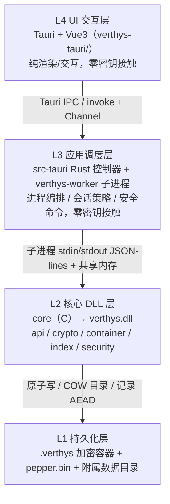
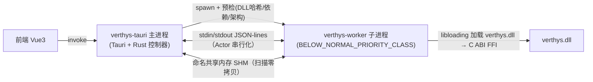

# ARCHITECTURE — Verthys 总体架构

> 梳理 Verthys 四层架构、core 五大子域职责、进程模型与 core/前端边界，作为全仓技术蓝图。
>
> Last updated: 2026-11-19 · 维护人：K1Super

---

## 1. 系统分层

Verthys 采用四层单向依赖架构。密钥与明文仅存在于核心 DLL 层（及其下 CNG 内核托管），上层不接触任何密钥材料。



要点：

- L4 纯渲染，仅通过 Tauri `invoke` 调用命令，口令、密钥不出前端。
- L3 由 `verthys-tauri`（Tauri 主进程）负责进程编排；具体 C 调用全部下沉到独立子进程 `verthys-worker`，主进程与 worker 间用 `stdin/stdout` JSON 行协议通信，扫描结果经命名共享内存零拷贝传输。
- L2 是对外黑盒：仅暴露 `verthys.h` 白名单 ABI（导出面由 `verthys.def` 白名单管控），加密算法、容器格式、内存防护均内部封装。
- L1 是磁盘持久化：`.verthys` 为唯一容器格式；pepper 由 OS 加密存储（`%APPDATA%\Verthys\pepper.bin`）；容器附属数据（`state.json` / `preset.json` / `import.wal` / `import.wal.snapshot` / 块台账 / `container.lock`）统一落在附属数据目录 `<容器路径>.d/`。

## 2. core 五大子域职责

> 以实际目录 `core/src/*` 为准。代码采用模块化镜像子目录（如 `api/lifecycle/`），非扁平单文件。

### 2.1 api/ — 公共 ABI 门面
`lifecycle/verthys_api.c` 承载句柄生命周期、容器打开/创建/锁定；`lifecycle/verthys_security_runtime.c` 承载巡检定时器、句柄注册表与应急降级；`security/verthys_api_security.c` 承载预设、防御状态与诊断；`records/verthys_api_records.c` 承载记录读写；`status/verthys_api_status.c` 与 `container/verthys_api_container_inspect.c` 承载容器只读检查；`rollback/verthys_api_rollback.c` 承载回退锚点维护；`verthys_api_container.c` 承载记录 CRUD、改密、Flush 与共享校验，`verthys_api_container_pcr.c` / `_keyfile.c` / `_module.c` / `_rotate.c` / `_storage.c` 分别承载 PCR、keyfile、模块、全库轮换与存储压缩入口，跨文件契约见 `verthys_api_container_internal.h`；`transfer/verthys_export_import.c` 负责导出/导入/改密；`scan/verthys_scan.c` 提供扫描游标；`lifecycle/dllmain.c` 维护 TLS 标志。

### 2.2 crypto/ — 密码原语与密钥管理
`cipher/verthys_crypto.c` 提供 AEAD / Argon2id / HKDF / HMAC 等原语；`cipher/secure_mem.c` 提供安全内存；`pepper/verthys_pepper.c` 维护胡椒三层来源与恢复卡；密钥管理按职责拆为 `vty_keymanager.c`（路径/编码、用户密钥、槽位封开、keyfile 与范围 IO）、`vty_keymanager_meta.c`（A/B 元数据副本与 Keyring DataRoot）、`vty_keymanager_create.c`（创建与恢复码重建）、`vty_keymanager_open.c`（解锁与核验）、`vty_keymanager_journal.c`（轮换恢复日志）、`vty_keymanager_factor.c`（keyfile 因子与设备重封）、`vty_keymanager_persist.c`（保存与批量提交）、`vty_keymanager_session.c`（PCR 槽位与模块密钥访问），跨文件契约见 `vty_keymanager_internal.h`；`vty_rotate.c` 与 `vty_rotate_{io,begin,copy,commit}.c` 实现全库 DEK 轮换作业，内部契约见 `vty_rotate_internal.h`；`vty_kdf.c` / `vty_device_root.c` / `vty_recovery.c` / `vty_keyfile.c` / `vty_blake3.c` / `vty_util.c` 提供派生、设备根、恢复码、keyfile、哈希与工具原语。

### 2.3 container/ — 容器格式
`vty_format.c` 实现 A/B 元数据双副本与原子提交；`chunk/vty_keyslot.c` 管理密钥槽；`chunk/vty_chunk.c` 实现内容分片；`module/vty_module.c`（描述符、模块表与状态）与 `module/vty_module_{seal,enable,delete,recovery}.c`（封印/启用/删除/恢复槽）管理模块密钥与模块槽，跨文件契约见 `module/vty_module_internal.h`；`maintenance/` 承载空间压缩与代际安全删除；`shared/verthys_internal.h` 定义运行时上下文；`format/verthys_format.c` 负责导出/导入交换信封。

### 2.4 index/ — 索引
`vty_record.c` 记录编解码；存储层按职责拆为 `vty_store.c`（数据区打开/校验与空根）、`vty_store_node.c`（目录节点编解码与加密读写）、`vty_store_tree.c`（B+tree 读写/校验/统计/检查点）、`vty_store_bulk.c`（空库批量构建）、`vty_store_segment.c`（追加段读写与擦除）、`vty_store_cursor.c`（升序游标），跨文件契约见 `vty_store_internal.h`；仓库层按职责拆为 `vty_repo_leaf.c`（就绪守卫、模块路由、叶编解码、ID 分配器）、`vty_repo_record.c`（记录写入/读取/替换）、`vty_repo_scrub.c`（删除与擦除补偿）、`vty_repo_file.c`（文件叶与分片叶）、`vty_repo_query.c`（盲索引查询与迭代）、`vty_repo_rekey.c`（模块重写与清除）、`vty_repo_storage.c`（统计与压缩复制），跨文件契约见 `vty_repo_internal.h`。

### 2.5 security/ — 纵深防御
六层防线：`layer1_process_guard/job_isolation.c`（Job Object 隔离）、`layer3_hw_binding/`（cng_machine_key / hardware_binding / system32_loader，机器绑定）、`layer4_hook_defense/`（tls_loader / tls_callbacks / hook_scan，防 Hook）、`layer5_sandbox/process_sandbox.c`（进程 mitigation policy + OS 回读）、`layer6_closure/defense_closure.c`（基于 `DefenseFacts` 的 7 路径事实校验）；另有 `anti_analysis/`（anti_debug / anti_inject / syscall_direct 直接系统调用）、`memory/`（memory_guard / secure_allocator / hibernation_state）、`integrity/`（.vsec 验签 + .rhat 运行时哈希）、`emergency/`（三级应急响应）、`preset/`（安全预设双缓冲切换）、`lockout/`、`rollback/`、`state/`、`tpm/`、`caller_auth/`。

### 2.6 事务与一致性
C 层容器采用 A/B 元数据双副本 + 追加数据区，提交原子性由 `container/vty_format.c` 与 `index/store/vty_store_*.c` 保证。导入断点续传的 WAL、块归属台账与 GC 结算位于 Rust 仓储层（`repository/verthys_wal.rs` / `verthys_chunks.rs`），不进入 C 容器格式。

## 3. Tauri 调度层职责

`verthys-tauri/src-tauri/src/controller/` 现有控制器文件（含 `mod.rs` 与公共类型）：

- `worker_controller.rs` — worker 子进程生命周期（预检/异步启动/就绪检测/健康监控/销毁）
- `verthys_controller.rs` — 容器主流程命令（unlock/create/lock/flush 等）
- `verthys_batch_controller.rs` — 批量记录/扫描命令
- `key_controller.rs` — 全局主密钥派生/验证
- `scan_controller.rs` — 扫描游标命令
- `file_controller.rs` — 文件类命令
- `diag_controller.rs` — 诊断/防御状态查询
- `device_controller.rs` — 设备信息
- `preflight_controller.rs` — 预检命令
- `clipboard_controller.rs` — 剪贴板守卫
- `api_error.rs` / `types.rs` — 错误码与响应类型

安全命令集中在 `security_commands/commands/`：

- `brute_force.rs`、`session.rs`、`usb.rs`、`file_lock.rs`、`module_whitelist.rs`、`preset.rs`、`cleanup.rs`
- 支撑模块：`security_commands/{audit,auth,path_resolver,persistence,responses,state,tests}.rs`；Rust 侧 `security/` 模块（`brute_force`、`session_guard`、`usb_guard`、`module_whitelist`、`clipboard_guard`、`cleanup`、`background_patrol`）

### 3.1 导入域（会话 · 单写者 · 台账 · GC 守卫）

图片（拾光）与文件（清藏）两条导入链路共用同一写入通道（核对于 2026-09-28）：

- **会话**：`verthys_import_begin / checkpoint / end` 配会话日志（附属数据目录 `<容器>.d/import.wal`）
  承载断点与已提交集合；结束（成功）前必须先落盘块归属台账，落盘失败即拒绝
  结束并保留日志供续传。会话冲突（已有活跃会话 / 库未就绪）以结构化错误码
  （`E_IMPORT_SESSION_BUSY` / `E_VERTHYS_NOT_READY`）回传，前端按码分支，
  不做文案判定。
- **单写者**：全部块与元数据写入经 `state/import_writer.rs` 串行通道（前端不得
  直连 worker 写数据域，CI 锚点防回归）；会话创建时按日志结算块归属（已提交
  条目的 `chunk_ids` → 台账 owner），无法证明归属的历史条目冻结为不可回收值。
- **台账与回收**：`repository/verthys_chunks.rs` 记录块归属；`verthys_gc_orphan_chunks`
  只回收归属为空且已结算的块，回收前先结算，结算落盘失败即拒绝回收。
- **分片读取与流式落盘**：`read_user_file(path, offset, length)` + `user_file_stat`
  （越界即报错，单次分片上界 4MiB；缺省形态保持整文件读取语义）；导出与流式
  目标经 `write_user_file_stream` 三命令（分片追加 → fsync + rename 原子替换 /
  abort 清理暂存，失败不产生目标文件）。
- **清藏导入数据面**：宿主 `controller/file_import_controller.rs` 驱动 worker
  `runtime/file_import.rs`（流式读 / BLAKE3 / 文件级 KDF / 分块加密 / 密文暂存），
  前端只传路径与进度；导出 / 删除仍由 `composables/file-verthys/{useFileExport,useFileDelete}.ts`
  承担。拾光导入为 `controller/photo_media_controller.rs` + `runtime/media/*`。

## 4. 进程/线程模型

进程分工（与代码核实）：主进程 `verthys-tauri`（Tauri/Rust）作为唯一 UI 宿主；`verthys-worker.exe` 是独立子进程，承载 verthys.dll 与全部 FFI 调用。



关键事实（读 `worker_controller.rs` / `worker/session.rs` / `verthys-worker/src`）：

- 通信方式：主进程以 `tokio::process::Command` spawn 子进程，`stdin/stdout/stderr` 均 piped；请求/响应走 **stdin/stdout 单行 JSON 协议**（`protocol.rs` 的 `Request`/`Response`，`data`/`bin_data` 字段 base64）。就绪信号 `{"op":"ready"}` 由 worker 主动写入 stdout。
- 串行化：`WorkerSession` 内部为异步 Actor 模型，`mpsc` 请求通道 + 单 Actor 任务保证管道串行；全库轮换进度经 `v4_rotate_progress` 行流式回传。
- 扫描零拷贝：`scan_open`/`scan_fetch` 用随机命名共享内存（`VirtualLock`）传输记录明文，避免 JSON/base64 膨胀；`scansummary` 用 4MB 摘要 SHM。
- 进程隔离/沙盒：worker 启动前（加载 DLL 前）先应用进程级 mitigation policy（`WIN32K_SYSTEM_CALL_DISABLE`、`PROCESS_CREATION_DISABLED`、`IMAGE_LOAD_PREFER_SYSTEM32`、`IMAGE_LOAD_NO_REMOTE`，经 `Verthys_NotifySandboxAttrs` 通知 DLL）；子进程挂入带 `KILL_ON_JOB_CLOSE` 的 Job Object，父进程退出即回收。
- 优先级：worker 以 `BELOW_NORMAL_PRIORITY_CLASS` + `CREATE_NO_WINDOW` 启动，承载后台长尾任务，避免抢占 UI。
- 生命周期：spawn 超时 15s、就绪等待超时 5s、健康检查每 10s、销毁前等待 IO 完成（2s）再终止；worker 销毁后主进程侧 `key_lifecycle` 重置为 NoKey（与“worker 内存无 GMK”事实一致）。

线程模型：主进程 Tauri 多线程 tokio 运行时；worker 为单线程主循环（stdin 读行 → dispatch → FFI）承载 DLL；DLL 内部为“主调用线程 + 固定后台线程池（≤4 worker）+ 定时器线程”，总线程数受限。

## 5. core 与前端边界

- 唯一跨层契约：`core/include/verthys.h`（公共 C ABI，`VERTHYS_API_VERSION 0x0019`）与 Tauri command 清单。前者规范见 [CORE_API.md](CORE_API.md)，后者以 `verthys-tauri` 的 command 注册为准。
- 数据流约定：前端只能 `invoke` 命令 → worker actor → FFI → C core；反向经 JSON 响应 / SHM / 轮换进度回调。不得绕过 worker 直接加载 DLL。
- 密钥边界：口令经 worker 传入 `verthys.dll` 后即归属 L2，主进程不落盘、不缓存明文密钥（仅 Rust 侧 `locked_buffer` 短暂持有口令，用后清零）。

## 6. 关键设计决策（ADR 摘要）

> 完整记录见 [ARCHITECTURE_DECISIONS.md](ARCHITECTURE_DECISIONS.md)。下表为一句话摘要（编号沿用源稿，结论以代码为准）。

| 编号 | 一句话结论 |
|---|---|
| D-1 | 派生密钥在用户态受限栈帧瞬态存在并即时清零；CNG/TPM 仅用于胡椒与机器绑定托管（V3 CNG 密钥组已退役） |
| D-2 | 采用当前容器（双包裹 AND + A/B 元数据 + 追加数据区 + 模块槽），无历史格式兼容包袱 |
| D-3 | A/B 元数据双副本原子提交，单副本损坏不阻断打开 |
| D-4 | 关键防御检测器走 `Nt*` 直接系统调用（syscall_direct）绕过用户态 Hook |
| D-5 | 密钥自动轮换（时间/操作计数/手动/异常触发），内核态完成 |
| D-6 | 密钥相关结构走专用安全分配器（VirtualAlloc + 锁页 + 清零） |
| D-9 | 全库 DEK 轮换走“恢复码会话新库重建 + ReplaceFileW 单次原子替换（旧库同事务备份）”，旧恢复码继续有效；作业期间源库只读；keyfile 可按路径补录，Run 可跨进程取消；复制逐条回读校验，ID 分配器水位与已删除 file 模块场景均保真 |

## 7. 目录结构速览

```
core/
├── include/                verthys.h（公共 ABI）
├── schema/                 FlatBuffers schema（flatcc 编译，generated/）
├── src/
│   ├── api/                lifecycle/ transfer/ scan/ progress/ shared/ verthys_api_container_*.c
│   ├── crypto/             cipher/ pepper/ keyring/ rotate/ hash/ factors/ vty_kdf ...
│   ├── container/          shared/ format/ vty_format · vty_keyslot · vty_chunk · vty_module_*
│   ├── index/              store/ · repo/ · vty_record
│   ├── security/           anti_analysis/ emergency/ integrity/ layer1_process_guard/
│                           layer3_hw_binding/ layer4_hook_defense/ layer5_sandbox/
│                           layer6_closure/ memory/ preset/
├── tools/                  rhash_gen.c（.rhat 运行时哈希表构建工具）
└── tests/                  api/ container/ crypto/ index/ perf/ schema/ security/ · test_runner.c

verthys-tauri/src-tauri/src/
├── controller/             worker_controller · verthys_controller · key_controller ...
├── security/               brute_force · session_guard · usb_guard · module_whitelist ...
├── security_commands/      commands/<brute_force,session,usb,file_lock,module_whitelist,preset,cleanup>.rs ...
├── state/                  verthys_session · key_lifecycle · worker_lifecycle ...
├── worker/                 actor/ session/ protocol/ platform ...
└── infrastructure/         shared_memory · ipc_secure · process_guard · file_lock · audit ...
verthys-tauri/verthys-worker/
└── src/                    main.rs · runtime/（worker/dispatch/protocol/scan_shm/gmk/...）· defense.rs · log.rs
```
## 8. 照片原生数据面（Phase 4 收口后）

### 8.1 职责边界

| 层 | 负责 | 不负责 |
|---|---|---|
| L4 Vue | 选路径、进度、网格渲染、预览/原图展示、导出参数 | 不读照片字节、不做哈希/加密/解码、不持有密钥 |
| L3a Tauri 主进程 | `photo_*` 命令编排、路径授权、导入会话、单写者/WAL/台账、原子写盘 | 不做照片解码、不做块/meta 加解密 |
| L3b verthys-worker | 流式读盘、BLAKE3、缩略图/预览、块封装、记录读取与解密、VENC 打包/解析 | 不直接写用户目标文件、不决定 UI |
| L2 verthys.dll | 容器事务、块/记录 AEAD、名称/类型盲索引、扫描 | 文件调度与 UI |

### 8.2 命令面

- 导入：`photo_import_start / photo_import_cancel`
- 网格：`photo_meta_get / photo_meta_probe`
- 查看：`photo_preview_get / photo_full_begin / photo_full_next / photo_full_cancel`
- 导出：`photo_export_start / photo_export_cancel`
- 备份：`photo_parse_start / photo_restore_start / photo_restore_cancel`

### 8.3 已删除的桌面 JS 数据面

`importPipeline`、`photoWorkerPool`、`photo-crypto.worker`、`container-import.worker`、
`photo-decrypt-bridge`、`chunk-refs`、照片 `module_crypto` 逐记录调用与运行时
`photo.native*` 开关均已删除。浏览器开发模式保留独立回退：内存导入、
`parse-crypto.worker` 的 VENC 预览、`lib/crypto.ts` 的 VENC 打包/解析与 Canvas PNG。

### 8.4 回滚边界

桌面端不再提供运行时旧链路切换；回滚单位为上一版本安装包。新数据仍写入
标准 `TYPE_PHOTO_META` 与 `TYPE_PHOTO_CHUNK`（4MiB 块），旧版本按 `chunkIds`
数量读取，不依赖固定块长；`TYPE_PHOTO_PREVIEW` 对旧版本是未知类型，不参与
列表/删除/导出枚举。
