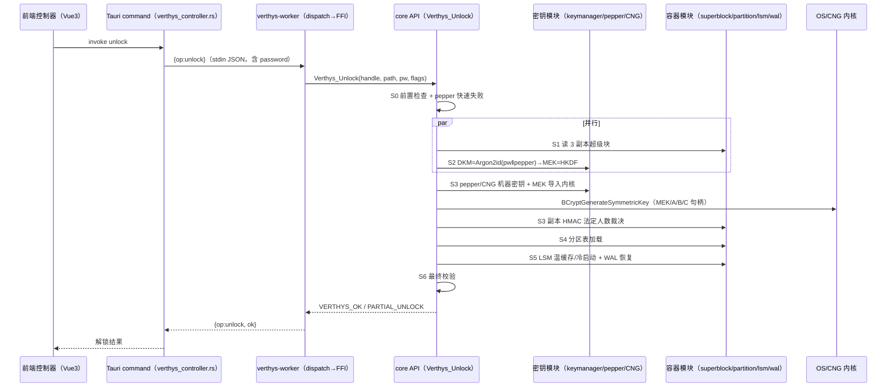
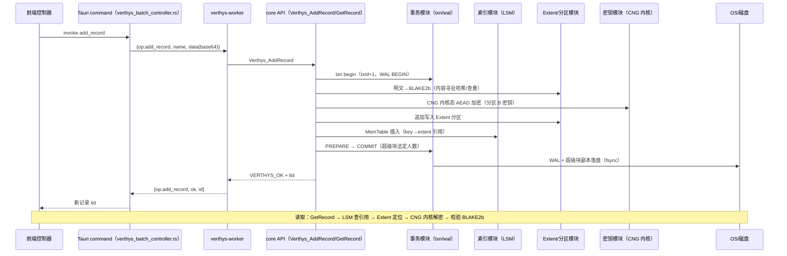
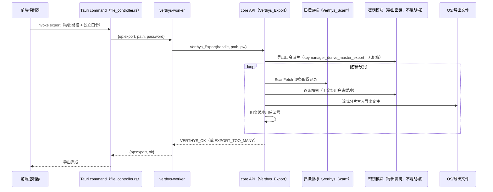
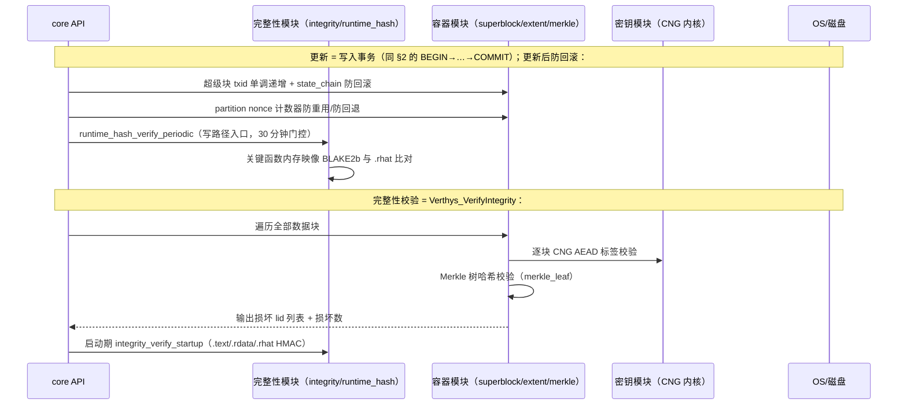
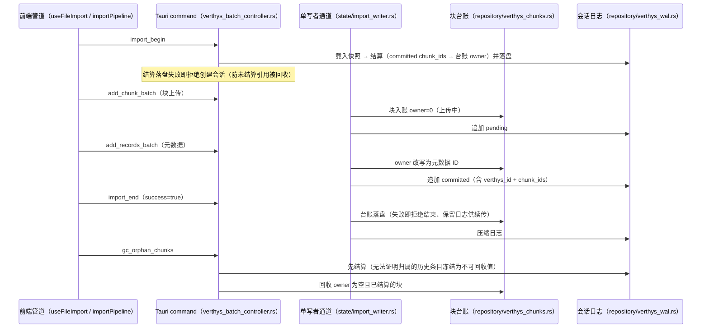
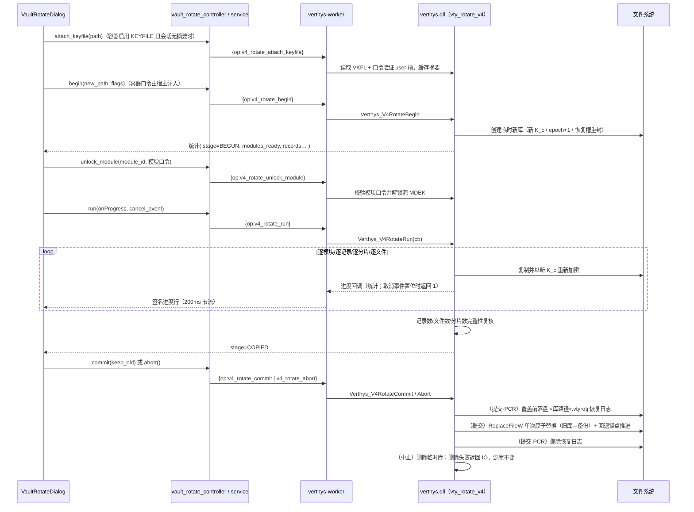

# DATA_FLOW — Verthys 关键数据流

> 用时序图说明解锁、加解密、导出、更新/完整性校验、导入域与全库 DEK 轮换六类跨层数据流，标注各方参与模块。
>
> Last updated: 2026-09-28 · 维护人：K1Super

---

> 调用链约定：前端控制器 → Tauri command → worker actor（stdin JSON）→ core API（C ABI）→ 容器/密钥模块 → OS/存储。核心 API 契约见 [CORE_API.md](CORE_API.md)，桥接命令以 `verthys-tauri` 的 command 注册为准。

## 1. 解锁流程

## 2. 加解密流程（单条记录写入 + 读取）

## 3. 数据导出流程

## 4. 更新/完整性校验流程

## 5. 导入域数据流（会话 · 台账 · 去重跳过与结算）

图片（拾光）与文件（清藏）两条导入链路共用同一写入通道：全部写入经单写者
串行，块归属由台账记账，孤儿块回收前先与会话日志结算。

### 5.1 导入会话与台账结算（含 GC 守卫）

### 5.2 续传幂等与删除释放

- **条目键**：`entry_key = SHA-256(source_path | size | mtime)`（解析导入为展示名/大小/序号）；
  非内容哈希，只用于断点续传幂等，不做内容寻址或存在性判定。键集合持久于会话日志。
- **块键**：`chunk_key = SHA-256("chunk" | entry_key | seq)`；记录名为 `chunk_<chunk_key>`，
  同一条目重试复用 ID，不同路径同内容各自落块。
- **导入**：条目键命中即"续传跳过"（不计失败、不入列表、显式报告）；
  不做内容级去重，同内容不同路径会分别导入。
- **删除**：记录批量删除并落盘成功后执行 `verthys_forget_import_keys`（日志追加删除墓碑）
  释放条目键，同一来源文件即可重新导入；释放失败转入待重试队列，由下次导入开始前补释放。
- **清藏删除**：块引用与元数据合并单次批量事务删除；删除提交后立即失效三层缓存
  并落盘。失败语义：删除失败保持原状可重试（零副作用）；落盘失败保持条目并提供
  "仅重放落盘"的重试入口（批量删除对缺失条目整体拒绝，删除步骤不可重放）；
  去重释放失败不改变删除结论。
- **内存口径**：分片读取上界 4MiB/次（越界即报错），块载荷在进程间层为 base64
  但受批量预算约束（≤11.19MiB/批）；导入/导出内存占用与文件大小无关。

## 6. 全库 DEK 轮换数据流（v4 D9，API 版本 0x0010）

仅恢复码会话可发起；源库作业期间只读。轮换在新文件中全量重建后原子替换，
旧恢复码继续有效。

关键约束：

- **只读窗口**：Begin 成功后源库 `rotate_pending=1`，记录/文件/模块/口令/PCR/keyfile
  写入口统一返回 `ROTATE_PENDING`；宿主 UI 不得在此期间放行写操作。
- **已删除文件模块**：源库 fileverthys `deleted` 时跳过文件/分片复制，仅允许
  墓碑；记录复制与提交照常，`next_id` 水位保留，已删除高位 ID 不复用。
- **复制自检**：记录/文件/分片写入新库后逐条回读比对，任何偏差返回 `VERIFY`，
  提交前不会把“计数相同但内容漂移”当成成功。
- **锁定/退出**：lockAll 先调用 `verthys_prepare_lock` 请求取消并等待全部轮换
  操作（Begin/解锁模块/Run/补录/Commit/Abort）在途计数归零（30s 上限），
  失败整体放弃锁定并保留会话；`verthys_lock`/`worker_destroy`
  内部保留同一闸门，并以会话代际（`session_epoch`）原子校验，代际已变返回
  `E_LOCK_SUPERSEDED`，延迟命令不得清空新会话；代际已变且无任何会话时
  补全释放无归属的哨兵锁与旧文件锁。空闲锁定仅在轮换命令在途时
  抑制（ready/failed 解除），安全边界在 Rust。进程级硬退出路径不可拦截，
  其崩溃窗口由 PCR 恢复日志兜底。
- **PCR 崩溃恢复**：Commit 在覆盖 PCR 密钥前落盘恢复日志；若进程在重封后、
  替换前退出，下次口令解锁仅当“日志与当前文件代/位图/策略摘要一致且平台
  PCR 未变”时用当前 `K_c` 重封并重新验证，否则 fail-closed（恢复码仍可打开）。
- **IPC 超时**：流式或普通请求超时后强制回收 worker（kill + 标记死亡），
  下一次请求从新进程开始，不读取旧序号残留行。
- **口令边界**：容器口令由主进程保管模块读取；模块口令只经本次 IPC 透传，worker
  不缓存、不写日志；恢复码不进入普通轮换请求。
- **失败态**：复制/复核失败进入 `FAILED`，只能 `Abort`；`Abort` 删除临时库并释放作业，
  源库保持原状。
- **提交后状态**：C 句柄指向新会话、恢复标记清零；宿主重建会话哨兵锁，前端同步
  收起恢复会话提示。