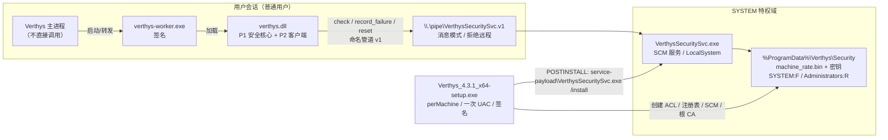

# Verthys P2 — SYSTEM 安全服务生产方案

| 项目 | 内容 |
| --- | --- |
| 状态 | 已实现（2026-11-08）：单安装包 perMachine 集成；D1 已修订为随应用安装；生产构建/安装/卸载实测通过 |
| 范围 | P2 独立立项：SYSTEM 安全服务、机器级节流、随应用单包安装与回滚 |
| 依赖前置 | P1 已完成（固定状态路径、ACL、设备绑定见证、迁移与 fail-closed） |
| 边界 | P2 不修改 P1 熔断/回滚语义，不混入 P1 代码；服务是强制依赖，未安装/不可达即 fail-closed |
| 编码规范 | 遵循仓库根 `.trae/rules/project_rules.md`；代码注释中文，符号与标准术语原文 |

---

## 0. 结论摘要

P2 以**独立项目**形式引入 SYSTEM 特权服务，解决 P1 无法解决的机器级问题：同一用户可删除自己的状态、不同用户无法共享同一份不可篡改的失败预算。方案要点：

1. 独立目录 `security-service/`，独立 CMake 工程、独立构建脚本、独立测试；安装/卸载随 perMachine 应用安装器完成；P1 的 `core/` 只改 `vty_machine_limiter.c` 一个实现点。
2. SYSTEM 服务 `VerthysSecuritySvc` 在 `%ProgramData%\Verthys\Security` 维护机器级令牌桶，状态目录 ACL 仅 SYSTEM 完全控制、Administrators 只读；非管理员无法删除或篡改。
3. 命名管道 `\\.\pipe\VerthysSecuritySvc.v1`，`PIPE_REJECT_REMOTE_CLIENTS`；服务端校验客户端进程 Authenticode 发布者指纹，客户端校验服务端 ECDSA 响应签名，双向认证，不依赖 PID/路径这类可伪造信息。
4. 服务只做**全局节流**（令牌桶 + 每用户请求配额），不做全局锁定；成功解锁不清空机器预算，防止任意客户端通过 reset 洗掉预算。
5. 服务是强制依赖；未安装、不可达、状态损坏、签名校验失败一律 **fail-closed**，不保留“服务缺失时回到仅本地熔断”的兼容路径。
6. 单安装包交付：应用安装器改为 perMachine，一次 UAC 内完成应用、SYSTEM 服务与根 CA。服务安装逻辑并入 `VerthysSecuritySvc.exe` 的 `/install`、`/uninstall`、`/repair` 等子命令，不再交付独立 `VerthysSecurityServiceSetup.exe`；取消 UAC 零残留，卸载清理服务、机器状态、事件源与根 CA。
7. 全链路门禁：服务单元测试、跨项目集成测试、P2 攻击回归、干净 VM 安装/升级/卸载、P1 全量回归 0 失败。

本方案的明确残余边界：**同一用户拥有代码执行能力时，仍可修改或绕过客户端调用**。P2 能阻止非管理员删除/篡改机器状态、阻止伪造服务端或未签名客户端，但不能把密码校验搬进服务；完整边界需要将口令校验下沉到特权组件，属于后续独立立项。

---

## 1. 目标与非目标

### 1.1 目标

| 编号 | 目标 | 可判定验收 |
| --- | --- | --- |
| G1 | 机器级失败预算不可由普通用户重置 | 非管理员无法写入/删除 `%ProgramData%\Verthys\Security`；删除/篡改后服务 fail-closed |
| G2 | 跨用户共享同一失败预算 | 两个不同用户进程调用同一服务，预算连续递减 |
| G3 | 服务端与客户端双向认证 | 未签名客户端被拒绝；伪造服务端响应被客户端拒绝 |
| G4 | 服务不可用时安全降级为拒绝 | 服务已安装但停止/崩溃/无响应时，解锁返回锁定 |
| G5 | 服务未安装即拒绝 | 删除/未安装服务后 `check` 返回锁定；P1 本地熔断仍独立记账 |
| G6 | 安装/升级/卸载/回滚 | 干净 VM 全流程通过；失败可回滚到上一服务版本 |
| G7 | 不引入新的本地提权面 | 服务只读请求参数、不执行客户端输入、不加载用户路径 DLL、静态 CRT |

### 1.2 非目标

- 不把口令派生、容器解密、密钥托管搬进服务；服务不接触任何用户口令、密钥、明文数据。
- 不实现全局硬锁定（永久锁死机器）；只做速率限制，预算随时间恢复。
- 不改变应用安装模式、Tauri 更新通道、worker 启动链。
- 不解决管理员/内核级攻击者；不依赖 TPM NV（实测不可用）。
- 不新增面向第三方开发者的公开 API；协议头只用于服务与 core 客户端共享。

---

## 2. 威胁模型与残余边界

### 2.1 防护对象

| 主体 | 能力假设 | P2 是否覆盖 |
| --- | --- | --- |
| 同一台机器上的其他普通用户 | 可运行任意用户态代码、可创建命名管道、可读写自己可写目录 | 覆盖 |
| 当前用户本人 | 可运行任意用户态代码、可 patch 自己进程内的 DLL | 部分覆盖（见 2.3） |
| 管理员 / SYSTEM / 内核攻击者 | 可改 ACL、停服务、改注册表、调试进程 | 不覆盖（超出威胁模型） |
| 远程网络攻击者 | 只能访问网络，不能访问本地命名管道 | 覆盖（管道拒绝远程客户端） |

### 2.2 攻击面与对策

| 攻击面 | 对策 |
| --- | --- |
| 删除/篡改机器状态 | 状态目录 ACL 仅 SYSTEM 完全控制；HMAC-SHA256 状态完整性；注册表锚点独立检测缺失 |
| 伪造命名管道服务端 | 客户端校验 ECDSA P-256 响应签名；私钥仅 SYSTEM 可读；公钥存 HKLM（普通用户只读） |
| 未授权进程调用服务 | 服务端校验客户端进程 Authenticode 发布者指纹（钉扎 SHA-256）与已加载 `verthys.dll` 签名 |
| 单用户刷失败拖垮全机器 | 每用户滑动窗口配额，单用户每分钟最多 6 次失败记账 |
| 通过 reset 洗预算 | reset 只做成功计数审计，不恢复令牌；预算只随时间恢复 |
| 服务停机绕过 | 注册表 `Installed=1` 且管道不可达 → 客户端 fail-closed |
| 时钟回拨 | 记录 UTC 单调推进；`now < last_refill` 时不补充令牌并记录事件 |
| 远程管道连接 | `PIPE_REJECT_REMOTE_CLIENTS` |
| 服务进程被替换 | 服务启动前校验自身 Authenticode 发布者指纹；安装器校验待安装文件签名 |

### 2.3 明确残余边界

1. **同用户代码执行**：当前用户可以 patch `verthys-worker.exe`/`verthys.dll` 跳过 `vty_machine_limiter_*` 调用。P2 无法阻止这种绕过；它阻止的是“删状态、换服务、伪造响应、跨用户重置”。要彻底解决必须把口令校验/密钥释放下沉到服务，属于新立项。
2. **管理员**：可停止服务、改 ACL、改注册表、替换已签名二进制。P2 不承诺对抗管理员。
3. **离线容器**：攻击者拿到容器文件后可在另一台机器离线爆破；P2 只约束本机在线尝试，不影响离线威胁模型。
4. **应用目录**：perMachine 安装到 Program Files 后，非管理员无法替换主程序；同一用户的内存注入仍属于本方案不覆盖的残余边界（见 2.3）。

---

## 3. 总体架构



### 3.1 进程与信任边界

| 组件 | 运行身份 | 职责 | 不做什么 |
| --- | --- | --- | --- |
| `verthys.dll`（P2 客户端） | 当前用户 | 读取 `Installed` 标记、连接管道、发请求、验响应签名 | 不读机器状态文件、不持有私钥 |
| `VerthysSecuritySvc.exe` | LocalSystem | 认证客户端、维护令牌桶、原子持久化、签名响应 | 不接触口令/容器/用户密钥；不执行客户端输入 |
| `VerthysSecuritySvc.exe`（`/install` 等子命令） | 应用安装器提权上下文 | 安装/升级/卸载/修复/状态查询 | 不生成私钥（由服务首次启动生成） |

### 3.2 部署拓扑

- 服务与机器状态由应用安装器统一安装、升级与卸载；应用升级时同一安装器升级服务，应用卸载时清理服务、机器状态、事件源与根 CA。
- 企业可用 GPO/SCCM 以已提权静默方式部署同一应用安装包，无需第二个安装器。
- 应用安装器改为 perMachine：应用装入 Program Files，服务由同一安装器在提权后从 `service-payload` 调用 `/install`；不再有首启独立安装（见 §15 D1）。

### 3.3 服务进程加固

- 启动即调用 `SetDefaultDllDirectories(LOAD_LIBRARY_SEARCH_SYSTEM32)`、`SetDllDirectoryW(L"")`、`SetErrorMode(SEM_FAILCRITICALERRORS | SEM_NOGPFAULTERRORBOX | SEM_NOOPENFILEERRORBOX)`。
- 应用进程缓解策略：DEP、CFG、禁止动态代码（`ProcessDynamicCodePolicy`）、禁用扩展点（`ProcessExtensionPointDisablePolicy`）、禁止远程/低完整性映像（`ProcessImageLoadPolicy`）。策略设置失败记录事件日志；核心策略（DEP/CFG）失败则拒绝启动。
- 静态 CRT（`/MT`），不依赖用户可写目录中的 CRT DLL；只链接系统 DLL，不在运行期 `LoadLibrary` 用户路径。
- 服务不使用 `ImpersonateNamedPipeClient` 执行业务逻辑；客户端提供的字节只用于定长字段校验与计数。

---

## 4. 目录与工程结构

```text
security-service/
├── CMakeLists.txt                  # 独立工程；读取仓库根 VERSION
├── include/
│   └── vty_svc_protocol.h          # 协议常量与定长结构（客户端/服务端共享）
├── src/
│   ├── service_main.c              # SCM 入口、生命周期、控制处理
│   ├── service_state.c/.h          # 状态目录/ACL/注册表锚点
│   ├── machine_state.c/.h          # 令牌桶、每用户配额、原子持久化
│   ├── state_crypto.c/.h           # HMAC 状态密钥、ECDSA P-256 签名密钥
│   ├── pipe_server.c/.h            # 管道实例、连接、超时、并发上限
│   ├── client_auth.c/.h            # 客户端 PID→映像→Authenticode→模块校验
│   ├── protocol.c/.h               # 请求校验、响应构造与签名
│   └── service_util.c/.h           # 宽字符/路径/事件日志/安全零化
├── setup/
│   ├── setup_entry.h               # 服务 exe 子命令入口声明
│   └── setup_main.c                # /install /uninstall /repair 等实现（编入服务 exe）
├── tests/
│   ├── CMakeLists.txt
│   ├── test_protocol.c
│   ├── test_machine_state.c
│   ├── test_state_store.c
│   ├── test_signing.c
│   ├── test_client_auth.c
│   └── test_acl.c
└── resources/
    └── messages.mc
```

仓库级新增：

```text
scripts/build/build_security_service.ps1    # 独立构建/签名/测试入口
tests/service/integration.ps1               # 控制台模式集成测试
tests/service/e2e-install.ps1               # 干净 VM 上的 SCM/安装 E2E
tests/service/attack.ps1                     # P2 攻击回归
```

**P1 边界**：除以下文件外，不修改 `core/` 其他文件。

| 文件 | 改动 |
| --- | --- |
| `core/src/security/state/vty_machine_limiter.c` | 由 no-op 替换为 P2 管道客户端实现 |
| `core/src/security/state/vty_machine_limiter.h` | 更新注释与测试钩子声明（语义契约不变） |
| `core/CMakeLists.txt` | 如有新增源文件/宏，仅追加最小项 |
| `core/tests/CMakeLists.txt`、`core/tests/test_runner.c` | 注册 P2 客户端测试 |
| `core/tests/security/test_machine_limiter.c` | 新增客户端映射/超时/签名拒绝测试 |

不修改 `vty_lockout.c/.h`、`vty_rollback.c/.h`、`vty_secure_state.c/.h` 的任何行为。

---

## 5. IPC 协议 v1

### 5.1 传输约束

| 项 | 值 |
| --- | --- |
| 管道名 | `\\.\pipe\VerthysSecuritySvc.v1` |
| 模式 | `PIPE_ACCESS_DUPLEX` + `PIPE_TYPE_MESSAGE` + `PIPE_READMODE_MESSAGE` + `PIPE_WAIT` |
| 远程 | `PIPE_REJECT_REMOTE_CLIENTS` |
| 实例 | 首实例 `FILE_FLAG_FIRST_PIPE_INSTANCE`；最大 8 个并发实例 |
| 缓冲 | 512 字节入 / 512 字节出 |
| 最大消息 | 请求 64 字节、响应 128 字节；超长直接断开 |
| 超时 | 服务端读 1 秒、写 2 秒；客户端连接 250 毫秒、应答 1 秒 |
| 编码 | 小端定长二进制；无 JSON、无字符串、无变长字段 |

### 5.2 请求（客户端 → 服务端，64 字节）

| 偏移 | 长度 | 字段 | 说明 |
| --- | --- | --- | --- |
| 0 | 4 | `magic` | 字节序 `'V','T','S','Q'`；按 u32 小端常量书写为 `0x51535456` |
| 4 | 2 | `version` | 固定 `1` |
| 6 | 2 | `command` | `1=Check`、`2=RecordFailure`、`3=Reset`、`4=Ping` |
| 8 | 4 | `request_id` | 客户端随机 32 位 |
| 12 | 4 | `reserved0` | 必须为 0 |
| 16 | 8 | `nonce_lo` | 客户端随机 64 位 |
| 24 | 8 | `nonce_hi` | 客户端随机 64 位 |
| 32 | 32 | `reserved1` | 必须全 0 |

服务端校验：magic、version、command 白名单、reserved 全 0、消息长度恰为 64。任一项失败返回 `BAD_REQUEST` 并断开，不计入预算。

### 5.3 响应（服务端 → 客户端，128 字节）

| 偏移 | 长度 | 字段 | 说明 |
| --- | --- | --- | --- |
| 0 | 4 | `magic` | 字节序 `'V','T','S','R'`；按 u32 小端常量书写为 `0x52535456` |
| 4 | 2 | `version` | 固定 `1` |
| 6 | 2 | `status` | `0=OK`、`1=LOCKED`、`2=DENIED`、`3=BAD_REQUEST`、`4=INTERNAL`、`5=UNAVAILABLE` |
| 8 | 4 | `request_id` | 回显 |
| 12 | 4 | `retry_after_sec` | `LOCKED` 时建议等待秒数，其余 0 |
| 16 | 8 | `nonce_lo` | 回显 |
| 24 | 8 | `nonce_hi` | 回显 |
| 32 | 4 | `remaining_tokens` | 诊断用；不向 UI 暴露 |
| 36 | 4 | `reserved0` | 0 |
| 40 | 8 | `server_time_sec` | UTC 秒，仅诊断 |
| 48 | 16 | `reserved1` | 0 |
| 64 | 64 | `signature` | ECDSA P-256 + SHA-256，raw `r||s` |

签名覆盖偏移 `0..63` 的 64 字节响应头（不含 `signature`）。客户端校验签名、magic、version、`request_id`、两个 nonce；任一不符即按不可信响应处理（fail-closed）。

### 5.4 命令语义

| 命令 | 状态变更 | 返回 |
| --- | --- | --- |
| `Ping` | 无 | `OK`；服务处于 fail-closed 状态时 `UNAVAILABLE` |
| `Check` | 仅补算并持久化随时间恢复的令牌 | 有预算 `OK`；无预算 `LOCKED` + `retry_after_sec` |
| `RecordFailure` | 通过每用户配额后消耗 1 令牌并持久化 | 记账成功 `OK`；配额超限或无令牌 `LOCKED` |
| `Reset` | 仅累加 `total_success`（审计），**不恢复令牌** | `OK` |

`Reset` 不恢复令牌是安全设计，不是遗漏：任何能运行签名客户端的用户都能调用 reset，若 reset 能恢复预算，机器级节流可被任意用户洗掉。预算只按时间恢复。

**签名不可用即关闭连接**：服务无法加载签名私钥时，不返回任何未签名响应，直接关闭管道连接；客户端按“服务不可达”处理并 fail-closed。

### 5.5 客户端认证（服务端 → 客户端进程）

服务端在 `ConnectNamedPipe` 返回后执行两级认证：先验证客户端映像签名，再读取并校验请求；只有预算类命令才额外要求已加载 `verthys.dll`。`Ping` 允许签名安装器用于安装就绪检查，不改变任何状态。

1. `GetNamedPipeClientProcessId` 取 PID；拒绝 PID 等于服务自身。
2. `OpenProcess(PROCESS_QUERY_INFORMATION | PROCESS_VM_READ)`，保持句柄到本次请求结束（阻止 PID 复用语义漂移，并为模块枚举提供权限）。
3. `QueryFullProcessImageNameW` 取映像路径；`WinVerifyTrust` + 发布者证书 SHA-256 钉扎（`WTD_REVOKE_NONE`、`WTD_CACHE_ONLY_URL_RETRIEVAL`，离线可用）。
4. `OpenProcessToken(TOKEN_QUERY)` 取用户 SID，用于每用户配额；哈希后仅在内存使用。
5. 读取并校验请求；`command ∈ {Check, RecordFailure, Reset}` 时，`EnumProcessModulesEx(..., LIST_MODULES_ALL)` 查找已加载的 `verthys.dll`，对其执行同样的发布者指纹校验；未找到或验签失败即拒绝。`command == Ping` 可跳过模块校验。
6. 任一失败返回 `DENIED` 并写事件日志（PID、用户 SID 哈希、失败原因），不消耗预算。

**为什么还要校验 `verthys.dll`**：仅校验 exe 时，签名宿主可加载未签名 DLL 绕过 P1 调用方认证；模块校验把“签名宿主 + 签名安全核心”这一组合作为客户端身份。它仍不能阻止同用户内存注入，属于 §2.3 残余边界。

### 5.6 服务端认证（客户端 → 服务端进程）

1. 客户端从 `HKLM\SOFTWARE\Verthys\SecurityService` 读取 `Installed`（DWORD）与 `ServerPubKey`（`BCRYPT_ECCPUBLIC_BLOB`，P-256）。读取后校验 blob 的 magic、长度与曲线参数，非法按缺失处理。
2. `Installed != 1`：视为部署不完整，不调用服务并返回 fail-closed。
3. `Installed == 1` 但公钥缺失/读取失败：fail-closed。
4. 连接管道、发送请求、读取响应。
5. 用 `ServerPubKey` 通过 CNG `BCryptVerifySignature` 校验响应签名；同时校验 magic/version/request_id/nonce。
6. 签名或字段不符：按服务不可信处理，返回 `VTY_E_LOCKED`。

**为什么不用共享密钥/HMAC**：客户端与服务端运行在同一台机器，任何写入客户端的密钥都可能被同用户进程读取；ECDSA 私钥只存于 SYSTEM 可读目录，客户端只持有公钥，才能让客户端在不持有秘密的前提下验证服务端。

### 5.7 错误映射（客户端）

| 场景 | `vty_machine_limiter_check` 返回 |
| --- | --- |
| `Installed != 1` / 注册表键缺失 | `VTY_E_LOCKED`（服务为强制依赖） |
| 响应 `OK` | `VTY_OK` |
| 响应 `LOCKED` | `VTY_E_LOCKED` |
| 响应 `UNAVAILABLE` / `DENIED` / `BAD_REQUEST` / `INTERNAL` | `VTY_E_LOCKED` |
| 连接失败、超时、签名失败、字段不符、注册表读取失败 | `VTY_E_LOCKED` |

`record_failure` / `reset` 的返回值沿用同一映射；调用方（`vty_keymanager.c` / `vty_module.c`）不新增分支。

### 5.8 服务端并发与停机模型

- 主线程循环 `ConnectNamedPipe`；每个已连接管道实例由一个工作线程处理，最多 8 个；第 9 个连接保持等待，不丢弃。
- 每次读写使用 overlapped I/O + `WaitForSingleObject` 超时；超时用 `CancelIoEx` 取消并关闭连接，防止恶意客户端长期占用实例。
- 请求处理顺序固定：客户端映像签名 → 请求校验 → 模块签名（预算类命令）→ 状态更新（`SRWLOCK` 独占）→ 响应签名 → 写回。
- 状态内存副本与磁盘写入在同一独占区内完成，保证“内存已扣减但磁盘未落盘”的窗口不会让下一次请求看到旧预算。
- 停止序列：`SERVICE_CONTROL_STOP` 置停止事件 → 停止接受新连接 → `CancelIoEx` 取消挂起连接 → 等待工作线程（最长 10 秒）→ 刷写状态 → `SERVICE_STOPPED`。
- 服务不执行客户端提供的任何命令、路径或代码；协议字段只用于查表与计数。

---

## 6. 密钥与状态

### 6.1 文件与目录

| 项 | 路径 | ACL |
| --- | --- | --- |
| 父目录 | `%ProgramData%\Verthys`（KnownFolder `FOLDERID_ProgramData`，不读环境变量） | protected DACL；SYSTEM/Administrators 完全控制、Users 读+执行；拒绝重解析点 |
| 状态目录 | `%ProgramData%\Verthys\Security` | protected DACL；SYSTEM 完全控制、Administrators 只读、Users 无权限；拒绝重解析点 |
| 机器状态 | `%ProgramData%\Verthys\Security\machine_rate.bin` | 继承目录 ACL；文件 ACL 不接受 Users |
| 状态 HMAC 密钥 | `%ProgramData%\Verthys\Security\machine_state.key`（32 字节） | 同上 |
| 服务签名私钥 | `%ProgramData%\Verthys\Security\service_signing.key`（`BCRYPT_ECCPRIVATE_BLOB`） | 同上 |
| 临时文件 | `machine_rate.tmp` | 同目录；启动时清理 SYSTEM 拥有的残留 |
| 服务安装目录 | `%ProgramFiles%\Verthys\SecurityService` | SYSTEM 完全控制、Administrators 完全控制、Users 读+执行；protected |
| 服务可执行 | 上述目录下 `VerthysSecuritySvc.exe` | 签名；Authenticode 发布者钉扎 |
| 安装器 | 应用安装器 perMachine | 一次 UAC；签名；POSTINSTALL 调用服务 exe `/install` |

目录创建顺序：安装器创建目录并施加 ACL；服务首次启动时复核 ACL、生成密钥、初始化状态、写注册表锚点。首次启动若目录不存在且 `StateInitialized` 锚点也不存在，服务按同一 ACL 规则创建目录；锚点存在但目录缺失则 fail-closed。安装器不生成私钥，避免私钥经过安装器进程。安装器在卸载/重置状态时启用 `SeTakeOwnershipPrivilege` 临时接管目录，操作完成后删除或恢复 ACL；服务每次启动都复核 ACL，发现被放宽即拒绝启动。

### 6.2 状态文件布局（v1）

| 偏移 | 长度 | 字段 |
| --- | --- | --- |
| 0 | 4 | magic `'VTMS'` = `0x534D5456` |
| 4 | 2 | 版本 `1` |
| 6 | 2 | 保留 0 |
| 8 | 4 | `capacity`（令牌上限） |
| 12 | 4 | `tokens`（当前令牌） |
| 16 | 8 | `last_refill_utc_100ns` |
| 24 | 8 | `total_failures` |
| 32 | 8 | `total_denied` |
| 40 | 8 | `total_success` |
| 48 | 8 | `created_utc_100ns` |
| 56 | 8 | `last_write_utc_100ns` |
| 64 | 32 | `hmac_sha256`（覆盖偏移 0..63） |

约束：

- `tokens <= capacity`；`capacity` 必须等于当前构建常量，否则视为不兼容并 fail-closed。
- 所有计数单调不减；HMAC 失败、magic/版本错、字段越界一律 fail-closed，不自动重置。
- 写入：同目录 `machine_rate.tmp`（`CREATE_NEW` + `FILE_ATTRIBUTE_TEMPORARY`）→ `FlushFileBuffers` → `MoveFileExW(MOVEFILE_REPLACE_EXISTING | MOVEFILE_WRITE_THROUGH)`。任何一步失败返回 `INTERNAL`，状态保持旧值。
- 持久化失败必须回滚本次内存中的令牌/计数修改，再返回 `INTERNAL`；禁止出现“内存已扣减、磁盘仍为旧值”的不一致窗口。
- 读取：`GetFileAttributesW` 先拒绝重解析点；`CreateFileW` 以 `FILE_SHARE_READ` 打开；文件大小必须精确等于布局长度。

### 6.3 注册表

`HKLM\SOFTWARE\Verthys\SecurityService`（64 位视图，`KEY_WOW64_64KEY`）。键 ACL：SYSTEM/Administrators 完全控制，Users 只读；安装器创建并加固键，服务只写自己的值。

| 值 | 类型 | 写入者 | 用途 |
| --- | --- | --- | --- |
| `Installed` | REG_DWORD | 安装器（就绪后） | 客户端强制启用开关；缺失/0 = fail-closed |
| `Version` | REG_SZ | 安装器 | 安装版本，诊断 |
| `InstallPath` | REG_SZ | 安装器 | 固定安装目录，诊断 |
| `StateInitialized` | REG_DWORD | 服务 | 状态已初始化的独立锚点 |
| `StateGeneration` | REG_DWORD | 服务 | 状态 schema 代数；当前 1 |
| `StateCreatedUtc` | REG_QWORD | 服务 | 首次初始化时间 |
| `ServerPubKey` | REG_BINARY | 服务 | ECDSA P-256 公钥 blob（客户端验签） |
| `ProtocolVersion` | REG_DWORD | 服务 | 当前 1 |

- `StateInitialized=1` 但状态文件/密钥缺失 → 服务进入 fail-closed 状态，不自动重建；只有管理员执行 `setup /reset-state` 才能重新初始化。
- `StateInitialized` 缺失且状态文件/密钥都不存在 → 首次运行，允许初始化。
- `StateInitialized` 缺失但状态文件或密钥任一存在 → 视为不完整初始化/篡改，fail-closed；由管理员 `setup /reset-state` 或 `/repair` 处理，不静默重建。
- `Installed=1` 但 `ServerPubKey` 缺失 → 客户端 fail-closed；安装器在就绪检查中也会失败并回滚。

### 6.4 密钥生命周期

| 密钥 | 生成 | 丢失处理 |
| --- | --- | --- |
| `machine_state.key` | 服务首次启动，`BCryptGenRandom` 32 字节 | 状态完整性不可判定 → fail-closed；管理员 `setup /reset-state` 归档旧状态并重建 |
| `service_signing.key` | 服务首次启动，CNG P-256 密钥对，导出私钥 blob | 公钥仍在注册表但私钥丢失 → 服务拒绝启动；`setup /repair-keys` 重新生成密钥对并更新公钥（状态不受影响） |
| `ServerPubKey`（公开） | 服务导出写入 HKLM | 缺失时服务启动会重写；注册表被清空且私钥存在 → 服务恢复公钥 |

私钥只以 `BCRYPT_ECCPRIVATE_BLOB` 形式落盘，ACL 与状态目录一致；服务启动时导入 CNG，导入失败即拒绝启动。私钥、HMAC 密钥不写事件日志、不写安装器输出、不进入诊断。

---

## 7. 限流算法

### 7.1 参数

| 参数 | 值 | 依据 |
| --- | --- | --- |
| 令牌上限 `capacity` | 10 | 允许正常用户短时间多次输入错误；同时限制机器级持续爆破 |
| 恢复速率 | 1 令牌 / 60 秒 | 持续攻击被限制在每分钟 1 次；正常用户误操作后可等待恢复 |
| 每用户失败配额 | 6 次 / 60 秒 | P1 阈值 5 次；配额略高 1 次，避免正常路径被服务端先拒 |
| 每用户全局令牌配额 | 6 个 / 10 分钟 | 防止单个用户持续消耗全部全局预算，造成对其他用户的拒绝服务 |
| 每用户配额时钟 | `GetTickCount64` 单调时钟 | 仅内存窗口，不受系统时间回拨影响 |
| 每用户配额存储 | 内存固定表（64 项，LRU） | 不落盘，服务重启清零；重启需要管理员权限 |
| 单实例并发 | 8 | 限制线程与 CPU |
| 每用户并发连接 | 2 | 防止单个用户占满全部实例 |
| 未认证连接读超时 | 1 秒 | 客户端连接后立即发送请求 |
| 服务端连接接受速率 | 50 次/秒（超出延迟 20ms） | 降低未认证连接洪水 |

### 7.2 计算

```text
elapsed = now_utc_100ns - last_refill_utc_100ns
if now < last_refill: elapsed = 0，记录事件（时钟回拨）
refill = floor(elapsed / (60s * 10^7))
tokens = min(capacity, tokens + refill)
last_refill += refill * 60s * 10^7
```

- `Check`：计算补充后的令牌；同时检查该用户 10 分钟窗口内的全局令牌配额。令牌为 0 或该用户配额耗尽 → `LOCKED`；否则 `OK`。不消耗令牌；若有补充则持久化。
- `RecordFailure`：先检查每用户每分钟请求配额与 10 分钟全局令牌配额；任一超限返回 `LOCKED`，不消耗全局令牌。未超限时：若 `tokens > 0` 则 `tokens--`、该用户配额计数 +1、`total_failures++`；否则 `total_denied++` 并返回 `LOCKED`。随后持久化。
- 每用户两个配额窗口都只存内存（`GetTickCount64` 单调时钟），服务重启清零；重启服务需要管理员权限。全局令牌与持久化状态则是跨重启的。
- `Reset`：`total_success++`，只在内存累加，最多每 60 秒随下一次状态写入落盘一次；不修改 `tokens`、`last_refill`。这样即使签名客户端高频调用 reset，也不会造成写放大。
- 状态写入串行化：`SRWLOCK` 独占写，读取共享；所有请求线程共享同一份内存状态，避免“读-改-写”竞态导致令牌超发。
- `Check` 不预留令牌：允许尝试与实际记账之间存在并发窗口，因此预算是“速率上限”而非严格线性化的并发闸门；超出量受管道并发上限与每用户配额约束。这是刻意的取舍——预留令牌会要求客户端在成功解锁时归还未使用的预留，重新引入“reset 洗预算”的路径。
- 预算为 0 时所有用户的解锁尝试都会在口令校验前被拒绝，直到下一个恢复周期。这是全局节流的明确可用性代价：若不在此之前拦截，攻击者仍可让 Argon2id 全速运行，节流失去意义。容量与恢复速率是可调参数（D4）。

### 7.3 与 P1 的关系

| 层 | 状态位置 | 作用域 | 清零条件 |
| --- | --- | --- | --- |
| P1 熔断 | `%LOCALAPPDATA%\Verthys\Security\lockout.state`（KnownFolder） | 当前用户 | 成功解锁 |
| P2 机器节流 | `%ProgramData%\Verthys\Security\machine_rate.bin` | 整机 | 只随时间恢复 |

两者独立累加：P2 不读取、不修改 P1 状态；P1 不读取 P2 状态。P2 的 `LOCKED` 与 P1 的 `LOCKED` 在客户端都映射为 `VTY_E_LOCKED`，不新增错误码，避免破坏既有 API 契约。

---

## 8. 客户端集成（core）

### 8.1 实现位置

`core/src/security/state/vty_machine_limiter.c`：

- 保留三个导出函数名与签名不变。
- 内部实现：注册表检测 → 管道连接（`CreateFileW` 后 `SetNamedPipeHandleState(PIPE_READMODE_MESSAGE)`）→ 请求/响应 → ECDSA 验签 → 错误映射。
- 仅使用 Windows API 与 CNG（`bcrypt.lib` 已由 core 链接）。
- 不新增全局可变状态；公钥每次请求从注册表读取（低频率），或进程内短缓存（≤5 秒）并在验签失败时强制重读。默认采用每次读取，减少缓存一致性风险。
- 所有缓冲区定长；请求/响应字段逐项校验；失败一律 `VTY_E_LOCKED`。

### 8.2 测试钩子（仅 `VERTHYS_TEST_HOOKS=1`）

| 环境变量 | 作用 |
| --- | --- |
| `VERTHYS_TEST_SERVICE_INSTALLED` | `1` 模拟已安装；`0` 模拟未安装（fail-closed） |
| `VERTHYS_TEST_SERVICE_PIPE` | 覆盖管道名（仅测试构建） |
| `VERTHYS_TEST_SERVICE_PUBKEY_PATH` | 从文件读取公钥，替代 HKLM（仅测试构建） |
| `VERTHYS_TEST_MACHINE_LIMITER_BYPASS` | `1` 仅供 P1 回归跳过机器预算调用；P2 C1/C7 撤销后验证 fail-closed |

生产构建不编译这些分支；`build_production.ps1` 显式 `VERTHYS_TEST_HOOKS=OFF`。

### 8.3 测试隔离

- 单元测试默认按“未安装”fail-closed，避免开发机安装了真实服务时测试消耗真实机器预算；P1 回归由 `test_runner` 显式设置测试旁路，机器预算客户端与 V4 接入用例组进入前撤销旁路、组结束后恢复，验证强制 fail-closed。
- 集成测试显式启用并指向测试管道/临时公钥。
- 任何测试不得访问 `%ProgramData%\Verthys\Security` 或真实服务名。
- 测试旁路只在 `VERTHYS_TEST_HOOKS=1` 构建中编译；产品二进制不包含该分支，不存在产品级回退。

### 8.4 调用时序

P2 的调用点必须位于真实产品入口，而不是已删除的旧解锁入口。当前唯一产品解锁面为 `Verthys_V4Unlock`、`Verthys_V4UnlockKeyfile`、`Verthys_V4UnlockRecovery` 与 `Verthys_V4ModuleUnlock`。

```text
V4 库解锁
  Verthys_V4Unlock / Verthys_V4UnlockKeyfile / Verthys_V4UnlockRecovery
    → vty_vault_open_internal / vty_vault_open_recovery
        → vty_machine_limiter_check()
            → Installed? 否 → VTY_E_LOCKED（服务强制依赖）
            → 是 → pipe Check → 验签 → OK/LOCKED
        → 口令路径：P1 库级熔断 vty_lockout_begin_attempt()
        → 恢复码路径：仅机器预算门（P1 无恢复码尝试计数）
    → 口令校验失败：P1 库级 record + vty_machine_limiter_record_failure() → pipe RecordFailure
    → 恢复码格式合法但认证失败：仅 vty_machine_limiter_record_failure()（格式错误在 KDF 前拒绝，不记账）
    → 校验成功
        → P1 库级 reset
        → vty_machine_limiter_reset() → pipe Reset（不恢复预算）

V4 模块解锁
  Verthys_V4ModuleUnlock → vty_module_unlock → desc_open_shares
    → vty_machine_limiter_check()（模块口令校验前）
    → P1 模块熔断 vty_lockout_module_begin_attempt()
    → 模块口令失败 → vty_machine_limiter_record_failure + 模块级 P1 record
    → 模块口令成功 → vty_machine_limiter_reset + 模块级 P1 reset

口令复核入口（ChangePassword / RotateBegin / keyfile 启用）
  → vty_vault_verify_user_password / vty_vault_attach_keyfile
    → 同样的机器预算门与失败/成功记账
```

服务调用失败不阻断 P1 本地记账；但 `check` 失败会 fail-closed，因此攻击者无法通过“让服务不可达”获得放行。

---

## 9. 安装、升级、卸载与回滚

### 9.1 安装器

`VerthysSecuritySvc.exe` 内置 `/install`、`/uninstall`、`/repair`、`/reset-state`、`/repair-keys`、`/status` 子命令，由 perMachine 应用安装器在管理员上下文调用。构建期从发布者证书链导出根 CA，把 DER SHA-256 钉扎进服务 exe；安装时先按固定指纹校验并导入 `LocalMachine\Root`，再校验服务 exe 发布者签名。不再构建独立安装器可执行文件。

服务安装后只接受发布者签名的客户端（worker + `verthys.dll`）；未签名开发构建会被服务拒绝并按 fail-closed 处理。开发机与 CI 不要安装生产服务，功能验证使用测试钩子构建与测试证书。

命令行：

| 参数 | 行为 |
| --- | --- |
| `/install` | 默认；安装或升级 |
| `/uninstall` | 停止并删除服务、注册表键、安装文件；默认删除机器状态 |
| `/repair` | 修复服务定义、ACL、注册表；不重置状态 |
| `/reset-state` | 归档并重建机器状态（仅在状态损坏且用户明确选择时） |
| `/repair-keys` | 重新生成服务签名密钥对并更新公钥；保留状态 |
| `/status` | 打印安装状态、服务状态、版本、ACL 检查结果 |
| `/quiet` | 无交互；错误通过退出码返回 |
| `/keep-state` | 卸载时保留机器状态 |
| ~~`/allow-downgrade`~~ | 已删除；降级一律拒绝，不保留旧版本兼容开关 |

退出码：`0` 成功、`2` 参数错误、`3` 不是管理员、`4` 签名校验失败、`5` 服务安装失败、`6` 服务启动失败、`7` 就绪检查失败、`8` 回滚失败。

### 9.2 安装步骤（严格顺序）

1. 校验提升权限、x64、OS 最低版本（Windows 10 1809+）。
2. 解析 `%ProgramFiles%`、`%ProgramData%`（KnownFolder，不读环境变量）。
3. 校验待安装 `VerthysSecuritySvc.exe` 的 Authenticode 发布者指纹与版本资源。
4. 若服务已存在：`ControlService(STOP)`，等待 `SERVICE_STOPPED`（最长 30 秒）；超时则失败退出，不强制终止。
5. 将旧 exe 复制为 `VerthysSecuritySvc.exe.bak`；新 exe 先写临时文件、校验哈希、`MoveFileExW` 原子替换。
6. 创建/加固 `%ProgramData%\Verthys`（SYSTEM/Administrators:F、Users:RX、protected）与 `%ProgramData%\Verthys\Security`（SYSTEM:F、Administrators:R、Users 无、protected）。若目录已存在：先检查重解析点（是则拒绝安装）；对普通目录接管 owner、施加 ACL；若 `Security` 内有状态/密钥但注册表没有 `StateInitialized` 锚点，将整个目录归档为 `Security.orphan-<UTC>` 后重建，绝不采纳未知来源状态；若锚点存在则保留状态，由服务启动时校验 HMAC 与密钥。
7. 服务已存在时 `OpenService` + `ChangeServiceConfigW` 更新 `lpBinaryPathName`、启动类型与错误控制；不存在时 `CreateServiceW`：`SERVICE_WIN32_OWN_PROCESS`、`SERVICE_AUTO_START`（不加 delayed，避免开机后短暂不可用）、`SERVICE_ERROR_NORMAL`、LocalSystem、无依赖、无桌面交互。
8. 设置服务描述、失败恢复动作（5s/10s/30s 重启，1 天重置）与服务 DACL：`D:(A;;CCLCSWRPWPDTLOCRRC;;;SY)(A;;CCDCLCSWRPWPDTLOCRSDRCWDWO;;;BA)(A;;CCLCSWLOCRRC;;;IU)(A;;CCLCSWLOCRRC;;;SU)S:(AU;FA;CCDCLCSWRPWPDTLOCRSDRCWDWO;;;WD)`。普通用户只能查询状态，不能启动/停止/配置服务。注册 Event Log 源，`EventMessageFile` 指向服务 exe 的消息资源。
9. `StartServiceW`，等待 `SERVICE_RUNNING`（最长 30 秒）。
10. 就绪检查（在写 `Installed` 之前）：轮询 `ServerPubKey`、`StateInitialized` 与签名 `Ping`；最长 30 秒。
11. 写入 `Installed=1`、`Version`、`InstallPath`。
12. 写事件日志。任一步失败 → 停止服务、恢复 `.bak`、删除新服务定义、删除/回退注册表，退出对应错误码；回滚失败返回 `8` 并保留现场。

### 9.3 升级

- 版本比较来自服务版本资源；降级一律拒绝。
- 升级保留 `machine_rate.bin` 与密钥；状态 schema 不兼容时服务 fail-closed，安装器在就绪检查失败后恢复 `.bak` 并重启上一已安装服务。
- 协议版本：只支持当前 v1；不保留 N-1 兼容，客户端与服务必须同版部署，协议不兼容即 fail-closed。
- 升级窗口内客户端会 fail-closed；安装器应尽量缩短停机（停止→替换→启动通常 < 2 秒），并在文档中要求升级时不要同时进行解锁操作。

### 9.4 卸载

1. `ControlService(STOP)`，等待停止；失败则中止卸载（不删除运行中的服务文件）。
2. `DeleteService`；等待 SCM 标记删除完成。
3. 删除 `Installed`，客户端立即 fail-closed；`/keep-state` 时保留 `StateInitialized`、`ServerPubKey`、`StateGeneration`、`StateCreatedUtc`、`ProtocolVersion` 等锚点值，非 keep-state 时删除整个 `HKLM\SOFTWARE\Verthys\SecurityService` 键。
4. 删除安装目录文件（含 `.bak`）。
5. 默认删除 `machine_rate.bin`、密钥文件；删除失败则保留并报告警告，退出码非 0 但服务已移除。
6. `/keep-state` 时不删除机器状态与密钥；再次安装会沿用旧预算与公钥，锚点存在使安装器接受既有状态。
7. 卸载不自动重启、不删除 Event Log 源（保留审计）。

### 9.5 回滚路径

| 场景 | 操作 | 结果 |
| --- | --- | --- |
| 新服务启动失败 | 安装器自动恢复 `.bak` | 上一已安装版本继续服务；状态保留 |
| 锚点缺失但状态 HMAC 有效 | `setup /repair` | 校验 HMAC/密钥后重建 `StateInitialized` 锚点，保留预算 |
| 状态损坏 | `setup /reset-state`（需明确确认） | 旧状态归档为 `.corrupt-<UTC>`，重建预算与审计；事件日志记录 |
| 签名密钥丢失 | `setup /repair-keys` | 生成新密钥对、更新公钥；状态不变 |
| 服务被误停 | `sc start VerthysSecuritySvc`（管理员） | 客户端恢复；无需重装 |
| 完全退出 P2 | `setup /uninstall` | 客户端 fail-closed（服务为强制依赖） |

**回滚不得删除 P1 状态**；P2 与 P1 状态互不引用。

---

## 10. 构建与发布

### 10.1 独立构建

`security-service/CMakeLists.txt`：

- `cmake_minimum_required 3.20`；读取 `../VERSION`，校验 semver。
- 语言 C11；x64；`set(CMAKE_MSVC_RUNTIME_LIBRARY "MultiThreaded$<$<CONFIG:Debug>:Debug>")` 静态 CRT，避免 CRT DLL 劫持。
- `include(../cmake/VerthysHardening.cmake)`，对所有目标调用 `verthys_apply_hardening`。
- 选项：
  - `VERTHYS_SERVICE_TEST_HOOKS`（默认 OFF；测试构建 ON，生产显式 OFF）
  - `VERTHYS_REQUIRE_SERVICE_SIG`（生产 ON；本地 OFF）
  - `VERTHYS_SERVICE_PUBLISHER_SHA256`（生产必填，64 位小写十六进制）
  - `VERTHYS_ROOT_CA_SHA256`（生产必填，根 CA DER SHA-256；由构建脚本从签名链导出并注入）
- 目标：`verthys_security_svc`、`verthys_service_tests`；`verthys_service_probe`/`verthys_fake_service` 仅测试构建。
- 版本资源：Company/Product/FileVersion 使用根 `VERSION`；协议版本写入资源或常量供 `/status` 输出。
- 链接库：`advapi32 wintrust crypt32 bcrypt shell32 ole32 psapi userenv version`（按实际使用裁剪）。
- 服务 exe（含安装子命令）与 core 均 `/MT`、`/guard:cf`、`/GS`、`/DYNAMICBASE`、`/HIGHENTROPYVA`、`/NXCOMPAT`、`/CETCOMPAT`、`/INCREMENTAL:NO`、Release `/LTCG /OPT:REF /OPT:ICF`。
- 服务入口：`wmain` 先处理 `--test-console`（仅测试构建），再按首参 `/` 分发 `/install` 等安装子命令，否则调用 `StartServiceCtrlDispatcher`；生产构建不包含 `--test-*` 分支。

### 10.2 构建脚本

`scripts/build/build_security_service.ps1`：

| 参数 | 说明 |
| --- | --- |
| `-BuildDir` | 默认 `build_security_service`（`.gitignore` 已覆盖 `/build_*/`） |
| `-Profile local|production` | production 强制签名与发布者指纹 |
| `-TestHooks` | 构建测试钩子版本，用于集成测试 |
| `-RunTests` | 构建后运行 ctest |
| `-NoSign` | 仅本地调试；产物标记不可分发 |

流程：加载环境（复用 `scripts/lib/env.load.ps1`）→ 从发布者证书链导出根 CA 并计算 SHA-256 → CMake 配置（注入发布者与根 CA 双 pin）→ 构建服务 exe → 签名服务 exe → 校验签名与根 CA 指纹 → 生成 `security-service.artifacts.json`（版本、协议版本、服务/根 CA SHA-256、发布者指纹、构建时间、是否测试钩子）→ 复制产物到 `build_security_service/artifacts/`。

签名顺序：服务 exe 使用 `scripts/lib/release_signing.ps1` 的发布者证书与时间戳服务；根 CA 指纹在编译前注入，无法在构建后替换。生产构建禁止 `-NoSign`，且缺少根 CA 或指纹不一致即失败。

### 10.3 与主构建脚本的关系

`build_production.ps1` 增加独立阶段（P2 接入时）：

- 新参数 `-SkipService`；默认构建服务并签名。
- 阶段顺序：核心 DLL → 服务（含根 CA pin）→ worker → Tauri；服务载荷 `VerthysSecuritySvc.exe` + `VerthysRootCA.cer` 复制到 `src-tauri/service-payload`，由 perMachine 安装器随包安装。
- 任一阶段失败立即终止，不继续打包。
- P2 首次接入由 perMachine 应用安装器随包安装服务，不再保留 perUser 首启安装路径。

### 10.4 CI

`.github/workflows/core.yml` 增加 `security-service` job（或独立 `security-service.yml`）：

1. Windows runner + MSVC x64。
2. 配置 `security-service` with `-DVERTHYS_SERVICE_TEST_HOOKS=ON`、`-DVERTHYS_REQUIRE_SERVICE_SIG=OFF`。
3. 构建并 `ctest --output-on-failure --no-tests=error`。
4. 运行 `tests/service/integration.ps1`（控制台模式，不安装服务）。
5. `tests/service/attack.ps1` 的无需提权部分（伪造服务、未签名客户端、状态篡改、停机语义）必须全 PASS。
6. 生产 OFF 构建（未签名）验证编译与静态检查；发布流水线负责真实签名。
7. 触发路径包含 `security-service/**`、`core/src/security/state/**`、`scripts/build/build_security_service.ps1`、`tests/service/**`。

SCM 安装 E2E 不在普通 CI 运行，只在一次性 Windows VM 上由 `tests/service/e2e-install.ps1 -AllowElevatedE2E` 执行。

---

## 11. 测试矩阵与验收门禁

### 11.1 服务单元测试（安全性关键路径）

| 编号 | 用例 | 断言 |
| --- | --- | --- |
| U1 | 协议编码/解码 | 合法请求通过；magic/version/command/reserved/长度非法全部拒绝 |
| U2 | 响应签名 | 正确密钥验签通过；错误密钥、篡改字段、篡改签名全部失败 |
| U3 | 令牌桶恢复 | 0 令牌 + 60s → 1；+600s → 10 封顶；时钟回拨不补充 |
| U4 | 令牌桶消耗 | 合成 SID 共 10 次消耗到 0；第 11 次 LOCKED；不出现负值 |
| U5 | reset 语义 | reset 后令牌数不变；只能增加 `total_success` |
| U6 | 每用户配额 | 同一 SID 第 7 次/分钟返回 LOCKED 且不消耗全局令牌；10 分钟窗口最多消耗 6 个全局令牌；不同 SID 独立 |
| U6b | 全局预算公平性 | 单 SID 持续失败 10 分钟，剩余令牌不少于 4；另一 SID 仍可 Check 成功 |
| U7 | 状态 HMAC | 篡改任一字节失败；缺少密钥失败；缺少状态但存在锚点失败 |
| U8 | 原子写入 | 临时文件残留不破坏旧状态；`MoveFileExW` 后内容完整 |
| U9 | ACL 校验 | 目录无 Users 写权限、protected、owner 符合预期；重解析点被拒绝 |
| U10 | 并发 | 32 线程并发 RecordFailure（合成 SID 注入）：全局令牌精确、无超发、无死锁；同 SID 并发受每用户配额约束 |
| U11 | 状态 schema | capacity/版本不匹配 fail-closed；计数回退视为损坏 |
| U12 | 事件日志 | 失败路径写事件且不包含密钥、口令、完整 SID |

### 11.2 core 客户端单元测试

| 编号 | 用例 | 断言 |
| --- | --- | --- |
| C1 | 未安装 | `Installed=0/缺失` → `VTY_E_LOCKED`，不连接管道 |
| C2 | 已安装 + 管道不可达 | `VTY_E_LOCKED` |
| C3 | 已安装 + 响应签名无效 | `VTY_E_LOCKED` |
| C4 | 已安装 + 合法 OK/LOCKED | 正确映射 |
| C5 | nonce/request_id 不匹配 | `VTY_E_LOCKED` |
| C6 | 超时 | 连接/应答超时均 `VTY_E_LOCKED`，不无限阻塞 |
| C7 | 测试构建默认 fail-closed | 未显式注入服务时返回锁定，且不触碰真实服务 |
| C8 | 已安装但公钥缺失/非法 | `VTY_E_LOCKED`（fail-closed） |

### 11.3 集成测试（控制台模式，无需安装服务）

| 编号 | 场景 | 断言 |
| --- | --- | --- |
| I0 | 测试隔离 | 测试前后真实 `%ProgramData%\Verthys\Security` 与真实 HKLM 键不存在或字节不变 |
| I1 | 服务启动 → Ping | `OK`，协议版本 1 |
| I2 | Check → RecordFailure ×1 → Check | 令牌从 10 → 9 |
| I3 | 不同 SID 共 10 次 RecordFailure → 新 SID Check | `LOCKED`，`retry_after_sec > 0`（测试构建可忽略每用户配额以验证全局桶） |
| I4 | 测试时钟推进 60s → Check | 恢复 1 令牌 |
| I5 | 未签名测试客户端 | `DENIED`，不消耗预算 |
| I6 | 伪造服务端（错误密钥） | 客户端 `VTY_E_LOCKED` |
| I7 | 服务重启 | 令牌数保持；状态文件 HMAC 有效 |
| I8 | 篡改状态文件 → 服务重启 | 服务 fail-closed，Ping `UNAVAILABLE` |
| I9 | 32 并发客户端 | 令牌计数精确，无崩溃 |
| I10 | reset ×N | 令牌不恢复 |
| I11 | 时钟回拨 | 不恢复令牌，写事件 |
| I12 | 请求超长/非法字段 | `BAD_REQUEST`，连接关闭，预算不变 |

### 11.4 P2 攻击回归

| 编号 | 攻击 | 期望 |
| --- | --- | --- |
| S-A1 | 删除 `machine_rate.bin`（普通用户） | 访问被 ACL 拒绝；服务 fail-closed |
| S-A2 | 直接改写状态字节（普通用户） | 写入被拒；若以管理员模拟，HMAC 失败仍 fail-closed |
| S-A3 | 启动伪造管道服务端 | 客户端验签失败，拒绝响应 |
| S-A4 | 未签名客户端调用 RecordFailure | `DENIED` |
| S-A5 | 签名客户端反复 reset | 令牌不恢复 |
| S-A6 | 单用户高频 RecordFailure | 配额拦截，全局令牌不被瞬时抽干 |
| S-A7 | 远程命名管道连接 | 连接失败（`PIPE_REJECT_REMOTE_CLIENTS`） |
| S-A8 | 停止服务后解锁 | 客户端 fail-closed |
| S-A9 | 伪造 `Installed` 注册表（普通用户） | HKLM 写入被拒 |
| S-A10 | 替换服务 exe 为未签名文件 | 服务启动自检失败；安装器拒绝安装 |

**执行环境**：S-A3/S-A4/S-A5/S-A6/S-A8/S-A9 可在控制台模式 CI 执行；S-A1/S-A2/S-A7/S-A10 需要真实 SCM 安装、管理员或第二台机器，只在干净 VM 的 E2E 中执行。测试客户端使用 `tests/attack/signing/New-TestCert.ps1` 生成测试证书并安装到 `CurrentUser\Root`，服务测试构建以该证书指纹为钉扎值；测试结束清理证书与信任。

### 11.5 SCM / 安装 E2E（干净 VM）

| 编号 | 场景 | 断言 |
| --- | --- | --- |
| E1 | 全新安装 | 服务 RUNNING、注册表值完整、目录 ACL 正确 |
| E2 | 应用探针 Check | 签名探针加载签名 `verthys.dll` 后直接发协议：`OK`；停止服务后 `LOCKED`；启动后 `OK` |
| E3 | 升级 | 状态保留、版本更新、服务自动启动 |
| E4 | 降级 | 一律拒绝；不提供旧版本兼容开关 |
| E5 | 重启 | 服务自动启动、状态保留 |
| E6 | 非管理员操作 | 不能停止服务、不能读密钥、不能写状态、不能创建同名管道 |
| E7 | 卸载 | 服务/注册表/文件移除；应用 fail-closed（服务为强制依赖） |
| E8 | 升级失败回滚 | 恢复 `.bak` 并启动上一已安装版本；退出码 8 仅用于回滚失败 |

### 11.6 验收门禁（缺一不可）

1. **构建**：服务生产 OFF 钩子构建、测试 ON 钩子构建、core 生产 OFF 构建全部通过；附 CMake 命令与产物路径。
2. **测试**：服务单元/集成、core 全量（当前基线 270 项，执行时以实际 ctest 计数为准）、P2 攻击回归全部 0 失败；附 ctest/脚本输出摘要。
3. **关键路径**：干净 VM 上 E1–E8 实际执行并保留证据（日志、`sc query`、`icacls`、事件日志截图/文本）。
4. **签名**：服务与安装器均为发布者证书签名；未签名/错误指纹被拒绝的正负对照通过。
5. **P1 不回退**：P1 攻击回归 25 PASS、0 FAIL、1 SKIP（A6 离机样本）保持；P1 状态目录与语义未被修改。
6. **无测试钩子泄漏**：生产服务与 core 二进制不含 `--test-*` 分支、测试环境变量读取、测试公钥路径。

---

## 12. 运维与可观测性

### 12.1 事件日志

事件源 `VerthysSecuritySvc`（安装器注册，写入 Application 日志）：

| 事件 ID | 级别 | 内容 |
| --- | --- | --- |
| 1000 | Information | 服务启动成功，版本/协议版本 |
| 1001 | Information | 服务停止 |
| 1002 | Information | 状态初始化完成 |
| 1003 | Information | 安装/升级完成 |
| 2001 | Warning | 每用户配额触发 |
| 2002 | Warning | 机器预算耗尽（仅首次/窗口变化时记录，避免日志洪水） |
| 3001 | Error | 状态缺失/损坏，进入 fail-closed |
| 3002 | Error | 客户端认证失败（PID、SID 哈希、原因） |
| 3003 | Error | 自身签名校验失败，拒绝启动 |
| 3004 | Error | 时钟回拨，拒绝补充预算 |
| 3005 | Error | 状态/密钥写入失败 |

日志不含：口令、密钥、完整 SID、用户数据路径；SID 仅记录 SHA-256 前 8 字节十六进制。

认证失败、配额触发这类可被攻击者高频触发的日志按 10 秒窗口聚合并附带计数，避免连接洪水填满事件日志。事件消息表由 `mc.exe` 生成并编译进服务 exe，安装器把 `EventMessageFile` 指向该 exe，保证事件查看器可读。

### 12.2 诊断

- `setup /status` 输出：安装状态、服务状态、版本、协议版本、ACL 校验结果、状态文件存在性（不输出密钥）。
- 服务不提供远程管理接口；所有管理经 SCM 与安装器。
- 排障顺序：`sc query VerthysSecuritySvc` → `setup /status` → 事件日志 → `icacls "%ProgramData%\Verthys\Security"`。

### 12.3 性能预算

| 项 | 预算 |
| --- | --- |
| 服务常驻内存 | < 20 MB |
| 单次请求处理（含验签） | < 50 ms（不含客户端签名校验；WinVerifyTrust 可能更慢） |
| 单次请求处理（含客户端验签） | < 300 ms |
| 服务启动到 RUNNING | < 5 秒 |
| 状态写入（每次失败/成功） | < 10 ms；只在状态变化时写 |

客户端连接超时 250ms，保证服务故障时解锁延迟有界。

---

## 13. 实施阶段与门禁

| 阶段 | 内容 | 产出 | 门禁 |
| --- | --- | --- | --- |
| P2-0 | 方案评审（本文档） | 本文档 + 决策确认 | 已确认（2026-11-06） |
| P2-1 | 独立工程骨架、协议、状态、密钥、令牌桶、单元测试 | `security-service/` 可构建；U1–U12（含 U6b） | 单元测试 0 失败；无生产钩子 |
| P2-2 | 管道服务端、客户端认证、SCM 生命周期 | 可控制台运行的服务；C1–C8、I0–I12 | 集成测试 0 失败 |
| P2-3 | core 客户端接入 | `vty_machine_limiter.c` 实现；core 测试注册 | P1 全量（当前基线 270 项，执行时实测）+ P2 客户端测试 0 失败 |
| P2-4 | 安装器、ACL、注册表、升级/卸载/回滚 | 服务 exe 内置 `/install` 等子命令 + `installer-hooks.nsh` | 干净机一次 UAC 安装；取消 UAC 零残留；卸载清理服务/CA/事件源/ProgramData |
| P2-5 | P2 攻击回归 | `tests/service/attack.ps1` | S-A1–S-A10 全 PASS |
| P2-6 | 构建/CI/签名/文档 | 构建脚本、CI job、文档更新 | 生产签名产物 + 无钩子验证 |
| P2-7 | 全量回归与验收 | 汇报 | 11.6 全部满足 |

**编码开始条件**：已满足（2026-11-06 决策确认）。任何阶段发现方案与仓库事实冲突（例如 API 行为、SCM 限制、Tauri 打包限制），先修订方案再继续，不在错误前提上叠加实现。

---

## 14. 风险登记

| 编号 | 风险 | 影响 | 对策 |
| --- | --- | --- | --- |
| R1 | 同用户 patch 客户端绕过机器节流 | 安全边界有限 | 明确写入文档；完整修复需将口令校验下沉，另立项 |
| R2 | 服务停机导致应用解锁 fail-closed | 可用性 | 自动启动、SCM 恢复、快速升级、`/repair`、事件日志 |
| R3 | 状态/密钥损坏导致永久 fail-closed | 可用性 | `/reset-state`、`/repair-keys`；所有重建操作需管理员且留痕 |
| R4 | 管理员恶意操作 | 超出模型 | 文档声明；不依赖 ACL 对抗管理员 |
| R5 | 杀软/EDR 拦截服务安装 | 部署失败 | 安装器明确错误码；企业白名单；独立签名 |
| R6 | 升级期间协议不兼容 | 解锁失败 | 只支持当前 v1；不保留 N-1 兼容，必须同版部署 |
| R7 | 注册表公钥被管理员替换 | 可伪造服务端 | 管理员超出模型；客户端仍校验响应签名，替换需同时控制私钥 ACL |
| R8 | 机器时钟被管理员回拨 | 预算恢复 | 管理员超出模型；非管理员无 `SeSystemtimePrivilege` |
| R9 | 应用目录 | perMachine 装入 Program Files，非管理员不可写；同用户内存注入仍属残余 R1 |
| R10 | ECDSA 验签性能 | 解锁延迟 | 每请求一次验签；预算 < 300ms；必要时缓存公钥导入句柄 |

---

## 15. 已确认决策（最优方案）

以下决策已于 2026-11-06 确认，2026-11-08 按用户要求修订 D1：改为应用安装器 perMachine 单包集成，服务安装逻辑并入服务 exe。D3/D5 为安全不变量，编码与部署不得偏离；D4 可在不改变协议与状态 schema 的前提下依据遥测调整。

| 编号 | 决策 | 已确认方案 | 理由 |
| --- | --- | --- | --- |
| D1 | 服务分发方式 | **应用安装器 perMachine 单包集成；服务 exe 内置 install/uninstall 子命令；不再交付独立安装器** | 用户要求“装应用即装服务”、禁止二次安装；一次 UAC；更新同样一次 UAC |
| D2 | 服务端认证方式 | **ECDSA P-256 响应签名 + 客户端 Authenticode 校验** | 双向认证且客户端无需持有秘密；避免共享密钥被同用户读取 |
| D3 | reset 语义 | **不恢复机器预算，只记成功审计** | 防止任意签名客户端洗掉全局节流 |
| D4 | 限流参数 | **容量 10、1 令牌/60s、单用户 6 次/60s、单用户全局令牌 6 个/10min** | 兼顾正常误操作、机器级爆破限制与单用户 DoS 公平性；可在实现前调整 |
| D5 | 服务不可用语义 | **已安装即 fail-closed** | 用户已明确要求；避免“停服务即绕过” |
| D6 | 未安装语义 | **fail-closed（服务为强制依赖）** | 无旧版本兼容；部署必须包含服务；开发/便携环境需安装测试服务或使用测试钩子 |
| D7 | 状态目录 owner | SYSTEM，Administrators 只读 | 非管理员不可写；管理员超出模型 |
| D8 | 服务启动类型 | 自动启动（非延迟） | 开机即可用，避免登录后短窗 fail-closed |

上述方案已确认，P2-1 按此执行。

### 15.1 变更记录

| 日期 | 变更 | 状态 |
| --- | --- | --- |
| 2026-11-06 | 初版生产方案；D1–D8 采用最优方案确认 | 已确认，进入编码 |
| 2026-11-07 | 复核当前仓库事实：P1 测试基线由 478 修订为 270（旧代用例已删除）；P2 代码根纳入 `ci/check_version_naming.ps1` 扫描范围；测试构建补充 `--test-ignore-client-auth` 与 `--test-clock-offset-sec` 两个仅测试钩子参数 | 已确认，按修订版执行 |
| 2026-11-07 | 实现完成情况：U1–U12 单元测试 428 断言通过；I0–I12 集成 49 检查通过；S-A3/A4/A5/A6/A8/A9 攻击回归 10 检查通过；P1 全量 + C1–C8 实测 277 passed / 0 failed。环境事实：Windows 11 22631 的 `PIPE_REJECT_REMOTE_CLIENTS` 返回 ERROR_INVALID_PARAMETER（87），已回退为 `GetNamedPipeClientProcessId` 本地 PID 拒绝；运行期 DEP/CFG 策略在部分构建不可用，记录警告并依赖 PE `/NXCOMPAT` 与 `/guard:cf`。E1–E8 SCM E2E 需在提权干净 VM 执行，本机未执行。 | 已实现，E2E 待干净 VM 验收 |
| 2026-11-07 | 兼容路径清理：服务改为强制依赖，`Installed != 1` 一律 fail-closed；删除 `/allow-downgrade`，降级一律拒绝；删除协议 N-1 兼容承诺；移除 `VTY_REG_*` 别名层，统一使用 `VTY_SVC_REG_*` | 已执行，无旧版本兼容路径 |
| 2026-11-08 | 生产安装自举：服务安装器/服务二进制/发布根 CA 作为 Tauri resources 随包；首次启动应用内引导经 UAC 安装；安装器在服务自检前把根 CA 写入 `LocalMachine\Root`；服务构建阶段前移到 Tauri 打包之前；修复 PSModulePath 导致的签名钩子 Cert 驱动器缺失 | 已验证 |
| 2026-11-08 | 安装架构修订：应用安装器改 perMachine，单包一次 UAC 内安装应用+服务+根 CA；服务安装逻辑并入 `VerthysSecuritySvc.exe` 子命令，删除独立 setup 与首启安装；根 CA 双 pin、卸载移除；卸载清理服务/机器状态/事件源/CA/注册表 | 已验证 |
| 2026-11-07 | 接入缺陷修复：删除旧 `Verthys_Unlock` 与 `verthys_backoff_*` 死路径；机器预算门下沉到 `vty_vault_open_internal`、`vty_vault_open_recovery`、`vty_vault_verify_user_password`、`vty_vault_attach_keyfile` 与 `desc_open_shares`；新增 V4 解锁/模块解锁接入级回归 | 已验证 |

---

## 16. 实现状态（2026-11-08）

| 项 | 状态 | 证据 |
| --- | --- | --- |
| P2-1 独立工程/协议/状态/密钥/令牌桶 | 已实现 | `security-service/`；U1–U12 共 446 断言通过；生产 OFF 钩子构建通过 |
| P2-2 管道服务端/客户端认证/SCM 生命周期 | 已实现 | 8 实例消息管道、PID/SID/Authenticode/模块校验；I0–I12 49 检查通过 |
| P2-3 core 客户端接入（V4 主路径） | 已实现 | `vty_machine_limiter.c`；`vty_keymanager.c` / `vty_module.c` 认证收口；C1–C8 与 V4 解锁/模块解锁接入用例通过；P1 全量 + 接入用例 280 passed / 0 failed；旧 `Verthys_Unlock` / `verthys_backoff_*` 已删除 |
| P2-4 安装器/ACL/注册表/升级/卸载/回滚 | 已实现，本机验证 | 服务 exe `/install /quiet` 退出 0、服务 Running、`Installed=1`；`/uninstall /quiet` 后服务/注册表/事件源/ProgramData/根 CA 全部清除；perMachine 应用安装器随包安装路径已接入，干净 VM E2E 未执行 |
| P2-5 P2 攻击回归 | 控制台子集已通过 | S-A3/A4/A5/A6/A8/A9 共 10 检查通过；S-A1/A2/A7/A10 待 SCM/管理员/第二台机器 |
| P2-6 构建/CI/签名/文档 | 已实现 | `build_security_service.ps1`、`build_production.ps1` 阶段 3.6、`security-service.yml`、五份文档更新；无测试钩子生产二进制验证通过。发布签名改由 Tauri `bundle.windows.signCommand` 在 bundle type 补丁之后执行，安装包/卸载器/NSIS 插件副本同证书签名，安装包签名后重新生成 updater `.sig` |

已验证的环境事实：

- 生产服务 PE 具备 Dynamic base / NX / CFG / CET；服务仅依赖系统 DLL，无 CRT DLL。
- `PIPE_REJECT_REMOTE_CLIENTS` 在当前 Windows 11 22631 返回 87；回退后远程客户端由 `GetNamedPipeClientProcessId` 拒绝。
- 运行期 DEP/CFG 策略在部分构建不可用；链接期 `/NXCOMPAT` 与 `/guard:cf` 已生效，事件日志记录警告。
- P1 攻击回归以当前测试钩子构建执行：PASS=20、FAIL=4、SKIP=1；A2/A8/A18S 分别依赖签名宿主、内存转储与 worker 产物，属于 P1 既有门禁环境，不是 P2 回归。
- 事件日志消息表由 `mc.exe` 编译进服务 exe；10 个已使用事件 ID 经 `FormatMessage` 验证可解析。
- 生产 OFF 钩子测试可执行文件已修复链接缺陷并成功链接（执行仍需已安装服务或测试夹具）。
- P1 全量 + P2 接入用例在测试钩子 Release 构建实测 280 passed / 0 failed；生产 OFF 钩子 core DLL 与测试 exe 构建/链接通过，生产 DLL 不含测试钩子字符串。

- 生产安装失败根因已定位：服务以 LocalSystem 运行，自签名根 CA 仅在 `CurrentUser\Root` 时 WinVerifyTrust 失败，服务 Event 3003“self signature verification failed”拒绝启动；把根 CA 导入 `LocalMachine\Root` 后 `/install /quiet` 退出 0、服务 Running、`Installed=1`。服务 `/install` 现已在服务自检前按编译期指纹校验并导入随包 `VerthysRootCA.cer`。
- 旧的首启 UAC 二次安装路径已删除：应用安装包改为 perMachine，`installer-hooks.nsh` 在 POSTINSTALL 调用 `service-payload\VerthysSecuritySvc.exe /install /quiet`；应用包内不再包含 `VerthysSecurityServiceSetup.exe`。
- 服务 exe 子命令本机实测：生产签名服务从载荷目录 `/install /quiet` 退出 0、服务 Running；`/uninstall /quiet` 退出 0 后服务、HKLM 锚点、事件源、`%ProgramData%\Verthys`、安装目录与 `LocalMachine\Root` 中的 Verthys 根 CA 全部消失；再次 `/install` 可恢复。
- perMachine 单安装包本机实测：先卸载全部应用与服务，再以 `/S` 安装 `Verthys_4.3.1_x64-setup.exe`，退出 0；应用装入 `C:\Program Files\Verthys`，POSTINSTALL 从 `service-payload` 安装服务，`VerthysSecuritySvc` Running、`Installed=1`、状态目录 ACL 正确、主程序/服务/worker/DLL 全部 Authenticode `Valid`，应用启动日志出现 `[integrity_check] 主程序镜像签名核验通过`。包内无独立 setup.exe。
- 卸载本机实测：perMachine 卸载器 `/S` 退出 0；`Program Files\Verthys`、服务、HKLM 锚点、事件源、`%ProgramData%\Verthys`、`LocalMachine\Root` 根 CA、卸载项与桌面快捷方式全部消失；用户加密库 `%LOCALAPPDATA%\com.verthys.app` 保留。
- 最终生产包：`build/updater/releases/t3r27bt6bk9mm/Verthys_4.3.1_x64-setup.exe`，SHA256 `d0f023af...5242adf5c`，Authenticode `Valid`，清单哈希一致；本机最终安装后服务 Running、`Installed=1`、主程序 `Valid` 且 `[integrity_check]` 通过；卸载后程序/服务/CA/事件源/ProgramData/HKCU/HKLM/公共快捷方式全部清除，用户库保留。
- 最终回归：`security-service` 单元 CTest PASS；I0–I12 `49 passed / 0 failed`；攻击控制台子集 `9 passed / 0 failed`（S-A1/A2/A7/A9/A10 按环境 SKIP）；前端 Vitest `801 passed`；`vue-tsc` 与 `cargo check` 通过；生产构建 `-NoPause` 退出 0。
- UAC 取消由 Windows 在安装器进程启动前处理，属于干净 VM 验收项（本机为提权会话，无法复现标准用户取消路径）。

未验证项（交付时必须保持标注）：

- E1–E8 SCM/安装 E2E、S-A1/A2/A10 需要提权干净 VM；S-A7 需要第二台机器。
- 发布者证书签名：worker、`verthys.dll`、主程序、服务、NSIS 安装包签名均已复核 `Valid`；剩余仅需在干净 VM 上复验真实签名客户端的正向 Authenticode/模块校验。
- `build_production.ps1` 阶段 3.6 的子构建命令已在 PowerShell 5.1 下验证；完整生产管线依赖 Tauri/worker/发布证书环境。

---

## 附录 A：常量清单

| 常量 | 值 |
| --- | --- |
| 服务名 | `VerthysSecuritySvc` |
| 服务显示名 | `Verthys Security Service` |
| 管道名 | `\\.\pipe\VerthysSecuritySvc.v1` |
| 安装目录 | `%ProgramFiles%\Verthys\SecurityService` |
| 服务 exe | `VerthysSecuritySvc.exe` |
| 服务安装入口 | `VerthysSecuritySvc.exe /install`（随应用安装器调用） |
| 状态目录 | `%ProgramData%\Verthys\Security` |
| 状态文件 | `machine_rate.bin` |
| 状态密钥 | `machine_state.key` |
| 签名私钥 | `service_signing.key` |
| 注册表键 | `HKLM\SOFTWARE\Verthys\SecurityService` |
| 事件源 | `VerthysSecuritySvc` |
| 协议版本 | 1 |
| 请求 magic | 字节 `'VTSQ'`（u32 小端 `0x51535456`） |
| 响应 magic | 字节 `'VTSR'`（u32 小端 `0x52535456`） |
| 令牌上限 | 10 |
| 恢复间隔 | 60 秒/令牌 |
| 每用户配额 | 6 次/60 秒 |
| 每用户全局令牌配额 | 6 个/10 分钟 |
| 最大并发管道实例 | 8 |
| 客户端连接超时 | 250 ms |
| 客户端应答超时 | 1000 ms |
| 服务端读写超时 | 读 1 秒 / 写 2 秒 |

## 附录 B：P1 不变项清单

以下行为在 P2 中必须保持逐字节/逐语义不变：

- `vty_lockout_*` 的状态路径、ACL、见证 ID、迁移、fail-closed、指数退避与重置条件。
- `vty_rollback_*` 的设备+UUID 见证、generation 锚点、缺失状态语义。
- `vty_secure_state_*` 的 KnownFolder 解析、目录 ACL、重解析点拒绝、身份派生。
- `vty_keymanager.c` / `vty_module.c` 中 P1 熔断调用点与顺序：机器预算门在 P1 之前，口令认证后按结果记账；P1 自身语义不变。P2 只新增 `vty_machine_limiter_*` 调用，不改变 P1 状态与判定。
- P1 攻击回归 A7/A12 等探针与判定口径。

## 附录 C：评审检查表

- [ ] D1–D8 已确认或修订。
- [ ] 协议字段、状态布局、常量与实现计划一致。
- [ ] 客户端/服务端认证无共享秘密，无私钥进入用户态。
- [ ] 服务未安装、已安装可用、已安装不可用三种路径均有明确断言。
- [ ] 安装/升级/卸载/回滚均有失败处理与退出码。
- [ ] 测试矩阵覆盖 U/C/I/S-A/E 五类，且明确哪些在 CI、哪些仅在干净 VM。
- [ ] P1 文件改动清单最小化，未夹带无关重构。
- [ ] 文档更新范围（SECURITY_DESIGN、DEPLOYMENT、BUILD、TESTING、CHANGELOG）已列明。
