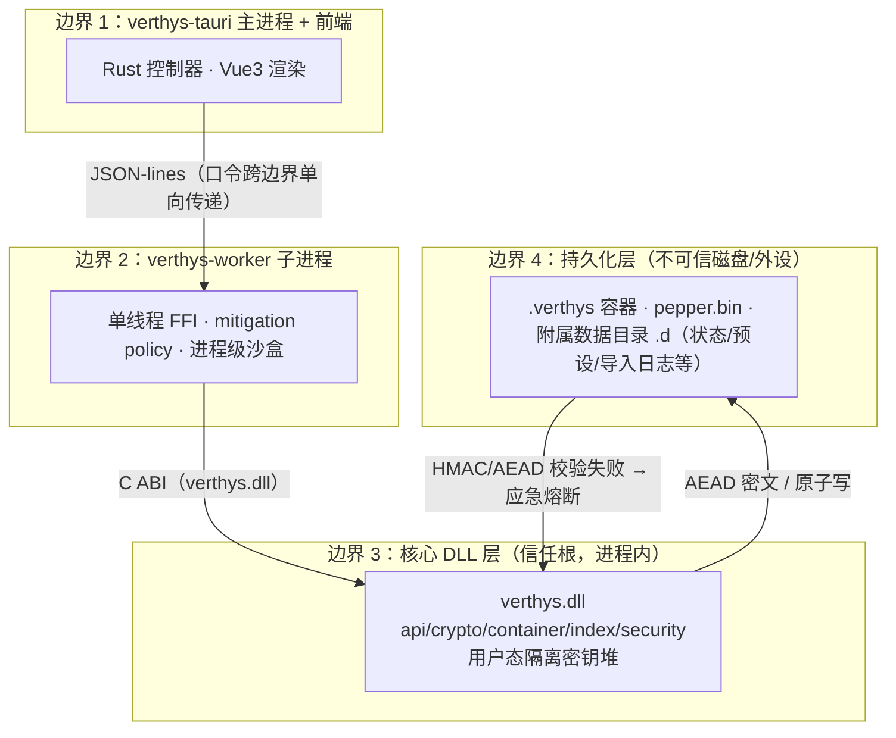
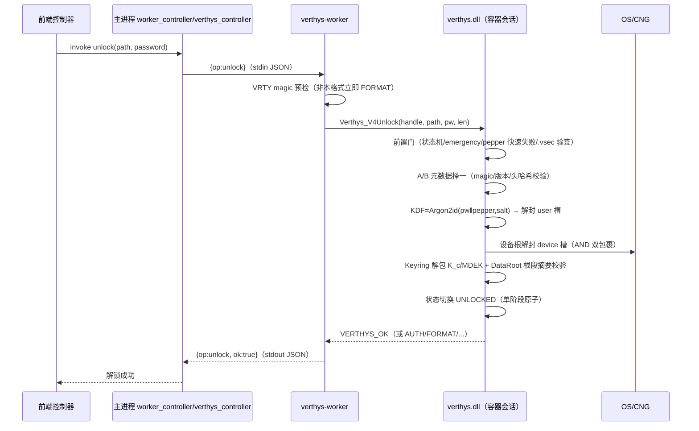
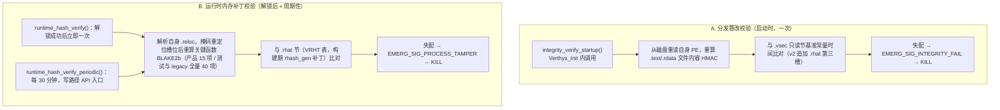

# SECURITY_DESIGN — Verthys 安全设计与信任模型

> 定义四层信任边界、密钥派生链路、哈希校验机制与威胁建模，供安全审计与应急处置参考。
>
> Last updated: 2026-09-28 · 维护人：K1Super

---

## 1. 信任边界

自底向上四条边界，密钥与明文只能单向向下沉降，任何一层不得向下层反授权。

- 边界 1↔2：跨此边界的唯一敏感数据是**口令**（调用后即清零）；传输走子进程管道。
- 边界 2↔3：只有 `verthys.h` 白名单 ABI 可进入 DLL；worker 加载 DLL 前完成进程级 mitigation 与 DLL SHA-256 预检。
- 边界 3↔4：落盘一律密文（分片 AEAD + A/B 元数据 MAC + Merkle）；只读回验，篡改即报应急。
- 密钥与明文只存在于边界 3 内（且密钥主体由 vty_vault 会话受控驻留），上两层为“零密钥接触”。

## 2. 密钥存储与派生链路

### 2.1 密钥层级（以 `vty_keymanager.c` / `vty_keyslot.c` / `vty_module.c` 为准）

- **全库数据密钥 `K_c`**：口令经 Argon2id 派生后解封 user 槽；设备根参与 device 槽；两个槽同时通过才得到 `K_c`（AND 语义）。
- **恢复通道**：恢复码经独立 KDF 解封 recovery 槽，承载同一 `K_c`；恢复码是显式逃生通道。
- **Keyfile 因子**：可选因子，独立验证后参与 user 槽解封；不改变 `K_c` 语义。
- **模块密钥 `MDEK`**：每个模块独立口令解封；模块失败不污染库级密钥与熔断。
- **生命周期**：`K_c` / `MDEK` 只在 `VtyVault` 会话内驻留；锁定、Deinit、应急清零统一经 `vty_vault_free` 释放。

具体派生参数、槽布局与 MAC 覆盖范围以代码为准；版本常量见
[`core/include/verthys_version.h`](../core/include/verthys_version.h)。

### 2.2 胡椒（pepper）三层来源

> `core/src/crypto/pepper/verthys_pepper.h` 定义；**编译内嵌胡椒为内部常量，本文档不抄录明文**，仅描述机制。

按优先级降序：

1. **注入胡椒**：调度层经 `verthys_pepper_inject` 从 OS 密钥存储（TPM/CNG/Keychain）注入，部署首选。
2. **OS 托管胡椒**：`verthys_pepper_load_from_os` 从 CNG 持久化机器密钥读取（TPM 绑定）；首次自动生成并持久化到 `%APPDATA%\Verthys\pepper.bin`（v2 布局 304B，含 `source_type` + `source_fingerprint`，机器密钥 RSA-OAEP 包裹，OAEP label = 硬件指纹）。解包失败 → 置来源错误，**禁止静默兜底**，解锁返回 `VERTHYS_ERR_PEPPER_SOURCE`（0x0C），提示“保险库安全源已变更”。
3. **编译内嵌胡椒**：确定性兜底常量，保证零配置可开箱（来源随容器记录于超级块 flags，解锁时校验一致性防漂移）。

胡椒恢复：`verthys_pepper_export_shamir / reconstruct_shamir`（GF(2^8) Shamir 秘密共享，threshold k-of-n）生成恢复卡分片。

### 2.3 机器绑定

`layer3_hw_binding` 三件套：`cng_machine_key`（CNG 持久化 RSA 机器密钥，wrap/unwrap 胡椒）、`hardware_binding`（system_instance 硬件指纹，作为 OAEP label 与跨设备校验依据）、`system32_loader`（系统目录优先加载）。跨设备迁移时胡椒解包认证失败 → 直接拒绝，对应防御路径 `CROSS_DEVICE`（见 §5）。

### 2.4 关于 “.vsec / .rhat”

澄清：`.vsec`（DLL 只读节，构建期签名基线）与 `.rhat`（DLL 只读节，运行时函数哈希表）是**完整性校验数据**，不是密钥存储；密钥拆分体现为容器内 user/device/recovery 密钥槽与模块槽，而非文件级拆分。详见 §4 与 [ARCHITECTURE.md](ARCHITECTURE.md) §2.5。

### 2.5 文件记录口令派生（文件级 KDF，2026-09-28 收口）

文件（清藏）记录可设独立访问密码，采用**文件级派生**，与容器级密钥体系相互独立、不混胡椒：

- **派生**：`文件密钥 = PBKDF2(口令, 文件盐, 150000 次)`；文件盐 16B 随机、每文件派生一次
  （历史逐块盐形态的写入路径已删除，旧记录读取保持兼容）。
- **块布局**：`iv(12B) ‖ 密文+标签`（AES-256-GCM）；每块唯一 IV、同一文件密钥。
- **口令判定唯一化**：记录携带 `passwordCheck`（固定明文的一次 AEAD）。导出时先解密
  校验 `passwordCheck` 判定口令（错误即 `E_PWD_WRONG`，发生在选择保存位置之前）；
  数据块解密失败一律按数据损坏归类，不再以“全部块解密失败”推断口令错误。
- **oracle 边界**：`passwordCheck` 与数据块 AEAD 属同类认证界面，不新增可离线攻击的
  新界面；口令强度由 PBKDF2 迭代数与用户口令共同承担。历史记录（无校验块）导出时
  显示“密码错误或数据已损坏”合并提示并给出可执行引导。
- **去重键不含口令材料**：文件级去重键 = `BLAKE3(明文 ‖ 格式版本 ‖ 形态标志)`；
  会话日志为明文落盘，任何口令派生量入键即构成可离线爆破的验证器，故同内容不同
  口令共用一键（换口令需先删除原记录）。
- **内存上界**：导入分片读取上界 4MiB/次，块载荷在进程间层为 base64 但受批量预算
  约束（≤11.19MiB/批）；导入与导出内存占用与文件大小无关。

台账与回收的完整性语义（会话结算、GC 前置守卫、删除事务化）见 [DATA_FLOW.md](DATA_FLOW.md) §5
与 [ARCHITECTURE.md](ARCHITECTURE.md) §3.1。

### 2.6 全库 DEK 轮换（D9，API 版本 0x0011）

容器以 `K_c` 作为全库数据密钥：口令 + 设备根（AND）解封 user/device 槽；
恢复槽独立承载同一 `K_c`（由恢复码派生的 `K_recovery` 包裹）。全库轮换
不是原地重写，而是“新文件全量重建 + 原子替换”：

- **前置**：仅恢复码会话可作为源库（`recovery_mode=1` 且持有 `K_recovery`）；
  非恢复会话返回 `POLICY`。
- **重建**：保留 `vault_uuid`，生成新 `K_c`，`epoch = source.epoch + 1`、
  `generation = source.generation + 1`；恢复槽复用源槽 salt/Argon2id 参数、
  换新 nonce 后用同一 `K_recovery` 重封新 `K_c`，因此**旧恢复码继续有效**；
  user/device 槽按调用方提供的当前容器口令（可选 keyfile 摘要）重封。
- **模块**：每个已启用模块必须先以模块口令登记（解锁源 MDEK），新库按同一
  口令重新启用模块并重封模块恢复槽；未登记即 Run 返回 `MODULE_LOCKED`。
- **Keyfile 补录**：容器启用 KEYFILE 但恢复会话未携带 keyfile 时，宿主可提交
  当前 keyfile 路径 + 容器口令，C 层读取 VKFL 摘要并用其验证 user 槽；认证
  通过才把摘要写入会话缓存，失败不修改任何会话字段。
- **PCR**：旧库有 PCR 槽且 TPM 可用时，在替换前重封新库；TPM 不可用时
  Begin 返回 `TPM`，调用方显式置 `DROP_PCR` 才允许移除绑定；高安全模式
  且未启用 keyfile 时，即使置位 `DROP_PCR` 也返回 `POLICY`（不得失去第二因子）。
  PCR 密钥名只由 `vault_uuid` 派生，重封即覆盖旧私钥——这是刻意的反回滚
  设计，旧槽位 + 旧副本无法继续通过 PCR 门。为覆盖“重封后、原子替换前”
  的进程崩溃窗口，提交在覆盖密钥前先落盘 `<库路径>.vtyrotj` 恢复日志：
  日志绑定库 UUID、源代与 PCR 策略摘要；下次口令解锁若 PCR 门失败，只有
  当日志与当前文件代、位图、策略摘要完全一致且平台 PCR 仍等于策略摘要时，
  才用口令解出的 `K_c` 重封并重新验证。平台状态变化时绝不自动重绑，否则
  等于用一次崩溃恢复绕过 PCR 策略。
- **内容一致性**：模块 MDEK 轮换时，每条内容记录的内层分片信封必须按旧
  MDEK/旧 epoch 解封、按新 MDEK/新 epoch 重封；照片索引的内联 `chunkDataB64`
  递归换封。逐条回读并验证新库可解封，任一失败返回完整性错误并中止作业，
  源库不替换（`rot_copy_records` + `vty_repo_rewrap_content`）。
- **keep_old + PCR**：保留的 `.old-*` 备份与源库同时被新密钥覆盖，其普通
  口令解锁会被 PCR 门拒绝，只能用恢复码打开；UI 在勾选保留备份且容器启用
  PCR 时给出该警示。宿主默认 `keep_old=true`：轮换是全库密钥重建，
  旧库是唯一可独立打开的兜底副本，用户显式取消才删除。
- **口令复核与熔断**：Begin / AttachKeyfile 的 user 槽验证与普通解锁共用
  持久化失败计数与退避窗口；失败按认证失败记账，成功清零。
- **只读与失败态**：作业期间源库 `rotate_pending=1`，所有写入口返回
  `ROTATE_PENDING`；复制失败进入 `FAILED`，只能 `Abort` 丢弃临时库。
- **取消**：宿主通过命名事件置位取消请求，worker 在 Run 前与进度回调中
  节流检查；回调在模块/记录/分片/文件边界触发，返回非 0 使 C 层进入
  `FAILED`，随后只能 `Abort`。
- **锁定/退出互斥**：lockAll 在任何破坏性步骤（清 GMK / 落盘 / 销毁 worker）
  之前调用 `verthys_prepare_lock`，由宿主先请求取消并等待全部轮换操作
  （Begin/解锁模块/Run/补录/Commit/Abort）在途计数归零（有界 30s）；
  仅等待 Run 会漏掉“换名与 PCR 重封期间销毁 worker”的窗口。
  失败则整体放弃本次锁定并保留会话与空闲计时。`verthys_lock` / `worker_destroy`
  内部保留同一闸门作为最后防线。等待期间会话可能被替换，销毁前用会话代际
  （`session_epoch`）在写锁内原子校验：代际已变返回 `E_LOCK_SUPERSEDED`，
  绝不清空新会话；若代际已变且当前无任何会话，则补全释放孤儿哨兵锁/文件锁。
  进程级硬退出路径无法被闸门拦截，其崩溃窗口由上述 PCR 恢复日志兜底。
- **空闲锁定抑制**：仅在轮换命令在途（前端 `processing`）时暂停空闲锁定；
  作业进入 ready / failed 后抑制解除，超时会话不得因对话框停留而永久驻留
  GMK（锁定会中止未提交作业，源库保持完整）。该抑制不是安全边界，Rust
  闸门独立生效。
- **超时回收**：worker 流式/普通 IPC 超时后强制终止子进程并标记死亡，
  避免残留旧序号进度/响应让下一次请求被误判为协议或认证故障。
- **提交**：复制完成后复核记录数/文件数/分片数，关闭源库与新库数据区句柄，
  用 `ReplaceFileW` 单次原子替换（源路径任一时刻都存在且内容完整，旧库
  同事务落为备份），再推进回退锚点；`keep_old=0` 时删除备份，删除失败
  不伪装成功。提交失败时同样用 `ReplaceFileW` 原子回滚。提交后句柄指向
  新会话，恢复标记清零。替换与锚点均完成后删除 PCR 恢复日志；若在删除前
  崩溃，下次解锁在 PCR 门通过（无需恢复）后清理该陈旧日志。
- **密钥边界**：`K_c`/`K_recovery`/模块 MDEK 只在 C 层与 CNG/安全内存中存在；
  worker 仅转发口令字节并回传统计计数，前端只拿到阶段与记录/文件/分片计数。

### 2.7 熔断与回滚状态：固定位置、ACL 与身份绑定

- **位置**：状态文件固定为 `SHGetKnownFolderPath(FOLDERID_LocalAppData)\Verthys\Security\{lockout,rollback}.state`，禁止读取 `LOCALAPPDATA` 等可改写环境变量；目录使用 protected DACL（当前用户与 SYSTEM 完全控制、Administrators 只读、继承 ACE 清零），并拒绝重解析点与非当前用户 owner。
- **身份**：见证域 ID 由设备根哈希（MachineGuid HMAC）与主体派生，输出 SHA-256 前 16 字节。熔断主体为当前用户 SID 哈希，回滚主体为容器 UUID；状态文件路径不再参与身份。
- **缺失状态**：任一见证域仍有密钥即 fail-closed；回滚额外要求容器 `generation >= 2`（成功创建至少一次 `save_meta`）也 fail-closed。只有状态、两套见证都不存在且 `generation < 2` 才视为首次运行；恢复码是显式逃生通道。
- **升级迁移**：旧路径见证（熔断）与裸 UUID 见证（回滚）只允许迁移期验证；验证通过后轮换到新 ID 并删除旧键。旧键的指纹是特定 TPM 密钥的公钥，删除后无法重建同一指纹，旧状态不可重放。迁移失败不静默清零。
- **残余边界**：同一用户进程仍可删除状态与见证，形成首次运行；ACL 只能隔离其它用户。TPM NV 在当前 Windows 平台被驱动阻断（实测 `0x80280400`），不作为方案依赖；严格机器级隔离预留在 `vty_machine_limiter` 接口，由后续 SYSTEM 服务在 ProgramData 维护机器级预算。

### 2.8 本机容器口令（`container.secret`）的位置与生命周期

- **用途**：安装版默认容器口令由本机生成（32 字节 CSPRNG，Base64 注入 C 层），以 DPAPI 绑定当前用户密封落盘；它参与 user 槽 KDF，是打开既有库的必要材料。
- **主位置**：`SHGetKnownFolderPath(FOLDERID_LocalAppData)\Verthys\KeyMaterial\container.secret`。该目录与熔断/回滚状态同源，不属于应用数据目录，卸载器“Delete the application data”不会删除。
- **便携/自定义数据目录**：口令保存在 `data_dir\container.secret`，保证数据目录整体可搬移；卸载器不处理自定义目录。
- **旧位置迁移**：修复前版本位于 `%LOCALAPPDATA%\com.verthys.app\container.secret`；首次读取时校验并原子复制到主位置，旧副本保留为只读兜底，不删除。
- **解锁语义**：普通解锁只接受既有密钥材料；主/旧位置都不存在时返回 `E_KEY_MATERIAL_MISSING`，不生成新密钥、不计入口令熔断。主位置损坏时可用旧位置有效副本恢复。
- **卸载保护**：`installer-hooks.nsh` 的 PREUNINSTALL 在删除应用数据前把旧位置副本转移到主位置；复制失败即中止卸载。
- **恢复通道**：恢复码不依赖该文件；恢复码解锁后需重绑本机设备槽（`reseal_device`），以当前密钥材料重封 device 槽。

### 2.9 内容外层探测（损坏扫描）

- **命令**：worker `module_probe_outer` 只验证分片外层（MDEK/epoch）能否解封：
  不校验布局种类标签（历史布局可能没有）、不派生每文件口令、不向前端返回明文，
  仅返回布尔结论。C 层接口仍是既有的 `Verthys_V4ChunkOpen`，不新增 ABI。
- **用途**：清藏损坏扫描在用户不提供每文件口令的前提下，判断分块是否已无法
  由当前模块密钥解封；照片损坏扫描复用同一能力但走 `module_open`（需要解析 meta）。
- **边界**：外层通过不代表内层口令密文正确；未设独立密码的文件（无内容层
  信封）与历史加密布局（缺 KDF/口令校验块）不参与探测，扫描结果中单独计数。

## 3. 解锁流程数据流

以 `vty_vault_open`（`core/src/crypto/vty_keymanager.c`）为准。

## 4. 恶意软件哈希校验链路

两层互补（读 `security/integrity/integrity.c` 与 `runtime_hash.c/h`、`core/tools/rhash_gen.c`）：

- **校验什么**：A 校验 DLL 文件 `.text`/`.rdata`（含 `.rhat`）未能被替换/篡改；B 校验关键函数（容器创建/解锁/分片/记录/模块/轮换、共享密码学/应急/完整性、`runtime_hash_scan` 自身）的**内存映像**未被 hotpatch。清单分两级：产品 DLL 含共享段 15 项（主路径实现 + 共享安全函数），测试构建使用全量 40 项。
- **何时执行**：A 在容器解锁入口（`Verthys_V4Unlock` / `Verthys_V4UnlockKeyfile` / `Verthys_V4UnlockRecovery` / `Verthys_V4Create`，`integrity_verify_startup`）；B 在解锁成功后一次 + 之后每次写路径 API（Add/Delete/Import/ChangePassword/Flush）经 `runtime_hash_verify_periodic` 时间门控重算（30 分钟间隔）。
- **惩罚**：失配即 `emergency_report(KILL, ...)` → 内存绝育 + 终止进程；`.rhat` 表自身纳入 `.vsec` HMAC（防文件级改表）。
- 构建闭环：`core/tools/rhash_gen.c --patch <dll|exe> [--xlist core|full]` 解析 map 文件（符号 RVA）+ `.pdata`（函数边界）+ `.reloc`（重定位表），对所选 X 清单函数计算 BLAKE2b 补丁 `.rhat`；清单以 X-macro 单源定义，删改任一符号即构建失败（禁静默降级）。

### 4.1 后台模块巡检的威胁分级（误报边界）

后台巡检（`security/background_patrol.rs` + `security/module_whitelist.rs`）对已加载模块做路径白名单与系统目录哈希基线校验，但“路径不在白名单”本身不是注入证据：NVIDIA App 的 `nvui.dll`、Bonjour 的 `mdnsNSP.dll` 等签名有效的第三方组件会正常注入所有进程。

- **硬威胁（可触发应急熔断）**：未知路径且 Authenticode 签名无效；系统目录哈希失配且签名无效；受信位置抽样签名失效。
- **软告警（仅日志与 `PATROL_SUSPECT` 审计，绝不销毁 Worker）**：未知路径但签名有效；系统哈希失配但签名有效（Windows Update 运行期换文件）；文件不可读导致哈希无法核验。
- **签名结论容忍离线**：先做整链吊销检查；失败时以“不检查吊销”复核一次，通过则记为 `ValidRevocationUnknown`（离线/CRL 不可达不等于未签名）。
- **持久化状态模式升级**：旧版按“路径即威胁”记录的计数与已触发集合在 schema < 2 时整体丢弃，避免历史误报继续压制或触发熔断。

## 5. 威胁建模（STRIDE 摘要）

| 威胁类别 | 攻击示例 | 防线模块 | 说明 |
|---|---|---|---|
| Spoofing 欺骗 | 伪冒合法进程/调用方 | brute_force（限流 + 一次性 auth_token）、session 守卫 | 解锁尝试限流，敏感命令需令牌 |
| Tampering 篡改 | 改 DLL/改 .verthys/内存补丁 | integrity（.vsec+.rhat）、容器元数据 HMAC、DataRoot 摘要、记录/分片 AEAD | 三类篡改各有信号（INTEGRITY_FAIL / PROCESS_TAMPER / CONTAINER_HMAC） |
| Repudiation 抵赖 | 操作无痕 | util/audit_log.rs + security_commands/audit.rs | 安全命令写入审计日志（AEAD 保护） |
| Information Disclosure 泄露 | 读内存/转储/冷启动 | memory_guard + secure_allocator + 进程隔离 | 密钥驻留独立隔离堆并在锁定/应急时清零；内核态密钥托管暂缓（用户态加固已生效，见 5.1） |
| Denial of Service 拒绝服务 | 资源耗尽/暴力爆破 | emergency（分级响应）+ 资源上限（512MB/句柄/线程）+ brute_force | 达到预算拒绝新操作、熔断 |
| Elevation of Privilege 提权 | 注入/Hook/进程镂空 | layer1 job_isolation、layer4 tls_loader+syscall_direct、layer5 process_sandbox、anti_inject | 进程级 mitigation + Job ACL 等效 PPL |

7 攻击路径闭环（`verthys.h VerthysDefensePath` = 内部 `DefensePath`）：挂起绕过 / 内存 Dump / 休眠取证 / IAT-Inline Hook / DLL 劫持·反射注入 / 进程读取 / 跨设备迁移，分别由 `layer1_process_guard`、`memory`、`layer4_hook_defense`、`layer5_sandbox + anti_analysis`、`layer3_hw_binding` 承接，`layer6_closure` 统一 BOOT/RUNTIME 校验（`Verthys_GetSecurityStatus` 反映 7 路径实时状态）。

### 5.1 七路径事实判定矩阵（API 0x0014）

判定输入统一为 `DefenseFacts`（会话事实 + 进程事实），不再以“模块已初始化”代替可观测证据。每条路径输出 `path_state` 与 `path_reason`；`Verthys_GetSecurityStatus` 追加 `path_reason[7]`、`limited_count`、`policy_flags`、`checked_at_unix_ms`（48 字节前缀保持不变，总 104 字节）。

| 路径 | 判定证据 |
|---|---|
| 挂起绕过 | 驻留密钥会话数 > 0 即 `DEGRADED`，原因 `SUSPEND_UNPREVENTABLE`；看门狗未接线追加 `SUSPEND_GUARD_INACTIVE`。主进程心跳（worker 每 500ms `SetEvent`）+ 3s 超时 + 全线程挂起确认后终止 worker 并触发外部锁定 |
| 内存 Dump | 解锁态存在驻留密钥即 `DEGRADED`（内核托管暂缓），锁定态 `BLOCKED` |
| 休眠取证 | `HKLM\SYSTEM\CurrentControlSet\Control\Power` 休眠状态：禁用 `BLOCKED`、启用 `DEGRADED`、未知 `UNCHECKED` |
| IAT-Inline Hook | 磁盘 ntdll 导出基线 + 内存入口字节比较 + IAT 槽校验；首次异常仅遥测，连续两次异常 `KILL`；自身 IAT 被改写且无直连系统调用证据时 `BLOCKED` |
| DLL 劫持 | `GetProcessMitigationPolicy` 回读 ChildProcess/ImageLoad/DynamicCode/StrictHandle/ExtensionPoint，核心位缺失即 `FAILED`；worker 自报 attrs 不再作为判据 |
| 进程读取 | 进程 Job/ACL 隔离与自我调试权限检查 |
| 跨设备迁移 | TPM PCR / 设备根 / 锚点绑定可用性 |

用户态上限项（`limited_count` 仅统计原因 2/5）与真实缺口严格分离：解锁态 `内存 Dump`、管理员可执行的挂起已启用用户态缓解（隔离堆/转储巡检、3 秒心跳看门狗处置），UI 显示“已加固（用户态上限）”，不显示为“未生效”；扫描不可用、证据陈旧、TLS 缺失等属可修复降级，不进入 `limited_count`。

## 6. 审计点清单

| 关键路径 | 审计点（函数/位置） |
|---|---|
| 解锁 | `Verthys_V4Unlock` → `vty_vault_open`（口令/设备根双槽解封 `K_c`） |
| 密钥注入/解包 | `vty_vault_open` / `vty_keyslot_unseal` / `vty_module_unlock` |
| pepper 来源 | `verthys_pepper_init / load_from_os`（来源错误置 `PEPPER_SOURCE`）、`pepper_source_error` |
| 改密/轮换 | `vty_keymanager` 改密路径、`vty_rotate_*` 全库 DEK 重建与原子替换 |
| 导出 | `Verthys_Export`（流式、明文经用户态缓冲，用后清零）；导出密码不混胡椒 |
| 完整性校验 | `integrity_verify_startup`、`runtime_hash_verify(_periodic)`、`Verthys_VerifyIntegrity` |
| 应急自毁 | `emergency_report / emergency_trigger`（TELEMETRY/DEGRADE/KILL 三级） |
| 提交一致性 | A/B 元数据双副本原子提交；`index/vty_store.c` 数据区游标推进 |
| 预设切档 | `security_apply_preset`（授权 → 原子落盘 → worker 切档 → C 投影回读，不一致回滚并报 `E_PRESET_VERIFY`）；落盘失败回滚置 `preset_persist_dirty` 阻断后续切档 |
| 自完整性核验 | `integrity_check::verify_self_image_async`（启动主镜像 WinVerifyTrust）+ 后台巡检抽样复核；结果写 `INTEGRITY_CHECK` 审计事件 |
| 痕迹清理 | `trace_cleanup::run_locked_cleanup_async`（锁定/退出触发）；仅删除指向应用自身痕迹域（`.verthys`/`.venc` 扩展名 + 应用自有目录前缀）的最近记录条目，写 `TRACE_CLEANUP` 审计事件 |
| 介质绑定 | `pre_unlock_guard`（解锁前卷序列号哈希比对，克隆嫌疑 fail-closed 拒绝）+ `post_unlock_commit`（DPAPI 持久化登记/重绑定） |
| 私有目录 ACL | 启动期对 `<data>/logs` 与 `<data>/tmp` 调用 `harden_private_dir`（仅当前用户/SYSTEM/管理员可访问），失败仅告警不阻断启动 |

## 7. 安全防护档位与特性契约

三档预设（BALANCED / SECURE / PERFORMANCE）与自定义档的策略唯一权威在 C 运行时策略层（`security_preset.c` 三档填充矩阵），Rust/TS/UI 仅只读消费，禁止本地可写副本与缓存回写权威。

### 7.1 特性位契约（11 位，位序跨层禁止重排）

位序：0=anti_debug，1=anti_inject，2=integrity_check，3=memory_guard，4=key_separation（历史遗留键名；映射密钥隔离堆），5=emergency_response，6=session_lock_on_idle，7=module_patrol，8=clipboard_guard，9=usb_clone_detect，10=trace_cleanup；有效掩码 `0x7FF`。

档位值：BALANCED `0x6FF`、SECURE `0x7FF`、PERFORMANCE `0x073`。C 层投影接口 `security_preset_feature_bits` / `security_active_preset` 为唯一口径；应用侧镜像 `app_feature_gate`（AtomicU32）按回读结果更新，未应用预设时按保守全开处理——任何异常路径朝"防护更严"方向失败。

### 7.2 红线能力（全档恒定，不随档位或用户开关关闭）

调试检测（anti_debug 全档恒开，性能档不减负）、注入拦截、密钥驻留隔离堆（`secure_allocator`，解锁态不可导出）、应急熔断（`emergency.c` 无条件 KILL 级）、锁定清空剪贴板、系统锁屏/注销/断连/挂起即锁定（WTS + 电源事件）、全局密钥导出二次验证。`key_separation` / `emergency_response` 两位由红线常量提供；其中 `key_separation` 为历史遗留位，产品构建不再链接旧三权分立实现，密钥由隔离堆承接。

### 7.3 特性执行路径（能力真实性）

| 特性 | 执行路径 |
|---|---|
| module_patrol | 后台巡检线程按动态周期扫描，门控关闭时仅维持线程与心跳 |
| integrity_check | 启动期主镜像签名核验（WinVerifyTrust，后台线程）+ 巡检轮次随机抽样已加载受信位置模块复核；失败不阻断启动/解锁（离线吊销检查可能误报），审计 + 日志可见 |
| usb_clone_detect | 解锁前置守卫：可移动卷序列号哈希与 DPAPI 登记比对，不匹配拒绝解锁并提供重绑定流程（全局密钥二次验证） |
| trace_cleanup | 锁定/退出时精确清理系统最近记录中指向应用自身文件的条目（COM 专用线程解析 .lnk，绝不触碰无关记录） |
| session_lock_on_idle | 前端会话计时器按档位超时应用；自定义档可显式关闭 |
| clipboard_guard | 语义 = 剪贴板监听（外部写入即清空）；锁定清空为恒定底线，不受该位影响 |

### 7.4 档位生效时机与信任链

解锁流程在凭据验证前按受信文件（`<verthys_path>.preset.json`，按本次容器路径派生）应用档位并回读校验，失败中止解锁（fail-closed）；本地 localStorage 仅作迁移来源与只读缓存，任何路径不得以其覆盖受信文件；运行期唯一写路径是用户显式切换（落盘 → 切档 → 回读 → 成功才更新 UI，并递增竞态版本号）。

显示器关闭锁定（display-off）：会话守卫注册 `GUID_CONSOLE_DISPLAY_STATE` 电源设置通知，仅高安全（SECURE）模式下显示器关闭执行锁定；`PowerSuspend` 不再受档位门控，始终触发锁库与 worker 销毁。通知注册失败仅降级为既有挂起监听。
## 8. 更新系统信任链

更新系统与业务密钥链路隔离，不读取容器内容，也不参与解锁与密钥派生。

| 层 | 作用 | 客户端信任根 |
|---|---|---|
| 安装包 minisign | 证明安装包字节来自发布者 | 内置更新公钥；插件下载阶段与 Rust 复验共用 |
| 清单签名 | 证明版本、兼容、下载地址与哈希未被篡改 | 清单公钥；production profile 强制 |
| Authenticode | 建立 Windows 系统信任与 SmartScreen 声誉（可选） | 开启时使用系统证书链；默认关闭，不依赖付费证书 |
| HTTPS | 保护清单与下载通道（默认） | 系统 TLS 信任链；零成本自建可显式放行 HTTP + IP |

本机 `local` profile 只使用回环 HTTP 与安装包签名；它防网络、其他账户、误替换与损坏，不防同账户任意写入。production profile 通过 HTTPS、清单签名与鉴权提高门槛。

安装前必须完成锁库落盘与脏数据检查；安装器只替换程序目录，用户容器不在替换范围。更新日志只记录阶段、错误码、耗时、版本与哈希前缀。

## 9. P2 机器级安全服务

P2 以独立 SYSTEM 服务提供机器级失败预算；服务是强制依赖，未安装、不可达、状态损坏或验签失败一律 fail-closed，不保留仅本地熔断的兼容路径。

| 组件 | 信任边界 | 关键约束 |
|---|---|---|
| `VerthysSecuritySvc.exe` | LocalSystem | 只在 `%ProgramData%\Verthys\Security` 维护令牌桶；不接触口令、容器或用户密钥 |
| `verthys.dll` P2 客户端 | 当前用户 | 只读 HKLM 公钥、连接命名管道、校验 ECDSA 响应签名；不持有私钥 |
| `VerthysSecuritySvc.exe`（`/install` 等子命令） | 应用安装器提升管理员上下文 | 只做安装/升级/卸载/修复；不生成私钥 |

协议为定长 64 字节请求 / 128 字节响应，小端二进制；服务端校验客户端映像与已加载 `verthys.dll` 的 Authenticode 发布者指纹，客户端校验服务端 ECDSA P-256 响应签名。服务已安装但不可达、状态缺失/损坏、签名失败一律 fail-closed；`reset` 只记录成功审计，不恢复机器预算。

客户端门禁位于认证收口：`vty_vault_open_internal`（V4 口令/keyfile 解锁）、`vty_vault_open_recovery`（恢复码解锁）、`vty_vault_verify_user_password` / `vty_vault_attach_keyfile`（改密、轮换、keyfile 复核）与 `desc_open_shares`（全部模块口令认证）。`check` 先于 P1 熔断与 Argon2id；失败同时记账 P1 与机器预算，成功同时 reset。

状态目录 ACL 为 SYSTEM 完全控制、Administrators 只读、Users 无权限；状态文件带 HMAC-SHA256，容量与 schema 不匹配按损坏拒绝。明确残余边界：同一用户拥有代码执行能力时仍可 patch 客户端跳过调用；管理员/内核攻击者超出威胁模型。完整威胁模型与决策见 `docs/P2_SECURITY_SERVICE_PLAN.md`。
