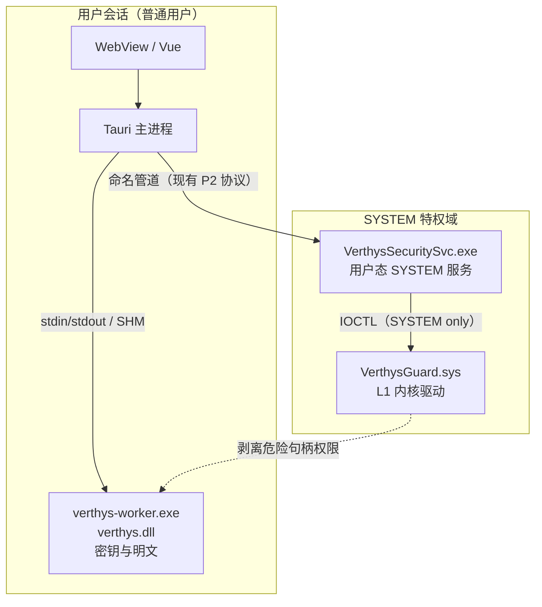

# 01 威胁模型

| 项目 | 内容 |
| --- | --- |
| 状态 | 评审稿 |
| 范围 | Kernel Guard L1：内核辅助访问控制 |
| 关联 | [README.md](README.md)、[02-architecture.md](02-architecture.md)、[03-driver-design.md](03-driver-design.md) |

> Last updated: 2026-11-21

---

## 1. 目的

本文定义 Kernel Guard 的防护对象、信任边界、攻击者能力、攻击路径与残余风险，作为后续设计、测试与安全声明的唯一威胁模型基线。

本文不重复 [SECURITY_DESIGN.md](../SECURITY_DESIGN.md) 的完整威胁模型，只补充内核层新增的边界与不承诺项。两者冲突时，以更严格的一方为准；涉及 P2 服务语义时，以 [P2_SECURITY_SERVICE_PLAN.md](../P2_SECURITY_SERVICE_PLAN.md) 为准。

---

## 2. 防护对象

| 资产 | 位置 | 泄露/破坏后果 | 本方案是否保护 |
| --- | --- | --- | --- |
| GMK、文件密钥、会话密钥 | `verthys-worker.exe` 进程内存 | 解密全部或部分照片 | 是，防止其他进程读取 worker 内存 |
| 解锁态明文照片、索引、缩略图 | worker 内存与共享内存 | 直接泄露用户数据 | 部分，防跨进程读取；不防同进程内被 patch |
| `.verthys` 容器 | 用户数据目录 | 离线爆破、删除、篡改 | 间接，加密与完整性已有；K3 才做文件写/删保护 |
| 预设策略文件 `preset.json` | 容器附属目录 | 降级高安全策略、关闭内核要求 | K1 不保护；K2 `required` 前必须解决 |
| P2 服务状态与机器预算 | `%ProgramData%\Verthys\Security` | 绕过机器级节流 | 不在本方案范围，P2 已覆盖 |
| 驱动与服务二进制 | `Program Files` | 替换后绕过保护 | 依赖 perMachine ACL、签名与完整性校验 |
| 审计日志 | 应用数据目录 | 抵赖、隐藏攻击 | 用户态审计已有；内核事件经服务落审计 |

---

## 3. 信任边界



| 边界 | 说明 |
| --- | --- |
| 边界 1：WebView → Tauri 主进程 | 前端不可信输入；现有 Tauri command 与路径授权已约束 |
| 边界 2：Tauri → worker | JSON-lines / SHM；worker 持有密钥与明文 |
| 边界 3：应用 → P2 服务 | 命名管道双向认证；P2 是 SYSTEM 用户态服务 |
| 边界 4：P2 服务 → 内核驱动 | 设备 ACL 仅 SYSTEM；应用不得直连 |
| 边界 5：内核驱动 → 受保护进程 | 只剥离句柄权限，不注入、不读内存、不改数据 |

### 3.1 前提假设

- 应用以 perMachine 方式安装到 `Program Files`，非管理员不可替换 worker/DLL/驱动
- 应用、worker、服务与驱动均使用可信签名；生产环境不使用测试签名
- P2 服务按现有语义运行；服务不可用时解锁已 fail-closed
- 受保护映像路径位于非管理员可写目录；per-user 安装不满足本方案的路径信任前提
- 驱动由微软签名或受控测试签名加载；管理员/内核攻击者不在威胁模型内
- 用户数据目录属于当前用户；本方案不改变其 ACL 语义

---

## 4. 攻击者能力

| 攻击者 | 能力假设 | 本方案是否覆盖 | 说明 |
| --- | --- | --- | --- |
| 同机其他普通用户 | 可运行任意用户态代码；不能读其他用户进程；不能写 Program Files | 覆盖 | ACL 与 P2 已覆盖大部分；Kernel Guard 不降低现有强度 |
| 当前用户本人（无管理员） | 可运行任意用户态代码；可打开自己的进程；可读写自己的数据目录 | 部分覆盖 | Kernel Guard 阻止跨进程读内存/注入/终止/调试；不阻止其复制容器离线爆破，也不阻止 UI 自动化 |
| 当前用户 + 恶意软件 | 可枚举进程、打开句柄、注入、Hook、Dump、删文件 | 部分覆盖 | L1 覆盖句柄类攻击；K3 才覆盖文件删改；不覆盖内核/管理员 |
| 管理员 / SYSTEM | 可改 ACL、停服务、加载驱动、调试进程 | 不覆盖 | 明确超出威胁模型；不在本方案承诺内 |
| 内核攻击者 / 恶意驱动 | 可读任意物理内存、绕过所有用户态与驱动策略 | 不覆盖 | 同机内核级攻击者无法在软件层彻底防御 |
| 远程网络攻击者 | 不能访问本地命名管道；不能直接访问本地进程 | 覆盖 | P2 管道拒绝远程；Kernel Guard 不新增网络面 |
| 离线攻击者 | 拿到 `.verthys` 容器，在另一台机器爆破 | 不覆盖 | 现有离线威胁模型不变；K3/K4 也不承诺解决 |
| 供应链/构建链攻击者 | 替换签名二进制、篡改构建产物 | 不覆盖 | 依赖签名、哈希钉扎与发布流程；不在本方案范围 |

---

## 5. 攻击路径与对策

### 5.1 同用户读取 worker 内存

```text
攻击进程
  → OpenProcess(PROCESS_VM_READ)
  → ReadProcessMemory
  → 读取 GMK / 文件密钥 / 明文
```

| 层 | 现状 | Kernel Guard |
| --- | --- | --- |
| 用户态 | `memory_guard` 扫描系统句柄表，发现后处置 | 不依赖扫描 |
| 内核 | 无 | `ObRegisterCallbacks` 剥离 `PROCESS_VM_READ/WRITE/OPERATION`，读取直接失败 |
| 残余 | 管理员可绕过；同进程内 patch 不覆盖 | 明确写入残余风险 |

### 5.2 同用户注入 worker

```text
攻击进程
  → OpenProcess(PROCESS_CREATE_THREAD / VM_WRITE / VM_OPERATION)
  → VirtualAllocEx + WriteProcessMemory + CreateRemoteThread
  → 在 worker 内执行代码
```

| 层 | 现状 | Kernel Guard |
| --- | --- | --- |
| 用户态 | `anti_inject`、`hook_scan` 检测 | 保留 |
| 内核 | 无 | 剥离 `PROCESS_CREATE_THREAD`、`PROCESS_VM_WRITE`、`PROCESS_VM_OPERATION`；线程对象剥离 `THREAD_SET_CONTEXT` |
| 残余 | 手动映射、内核注入、管理员调试 | 不在 L1 承诺内 |

### 5.3 同用户挂起/终止 worker

```text
攻击进程
  → OpenProcess(PROCESS_SUSPEND_RESUME / PROCESS_TERMINATE)
  → SuspendThread / TerminateProcess
```

| 层 | 现状 | Kernel Guard |
| --- | --- | --- |
| 用户态 | 心跳看门狗、挂起检测 | 保留 |
| 内核 | 无 | 剥离 `PROCESS_SUSPEND_RESUME`、`PROCESS_TERMINATE`；终止走 Job Object |
| 残余 | 管理员可终止；系统关机不受控 | 明确写入残余风险 |

### 5.4 调试附加与内存转储

```text
攻击进程
  → DebugActiveProcess / MiniDumpWriteDump
  → 读取调试事件或转储文件
```

| 层 | 现状 | Kernel Guard |
| --- | --- | --- |
| 用户态 | `anti_debug` 检测、`anti_dump` 策略 | 保留 |
| 内核 | 无 | 剥离 `PROCESS_VM_READ`、`PROCESS_SUSPEND_RESUME` 等调试所需权限 |
| 残余 | 管理员可加载内核调试器；WER 系统级转储策略 | 不在 L1 承诺内 |

### 5.5 文件删除、篡改与勒索

```text
攻击进程
  → DeleteFile / WriteFile / MoveFile
  → 删除容器、改写 preset.json、加密用户数据
```

| 层 | 现状 | Kernel Guard |
| --- | --- | --- |
| 用户态 | 完整性校验、审计、回退锚点 | 保留 |
| 内核 | 无 | K3 条件项：minifilter 拒绝非白名单写/删/改名 |
| 残余 | 管理员、内核攻击者、离线备份缺失 | K3 也不承诺对抗管理员 |

### 5.6 策略降级

```text
攻击进程
  → 改写 preset.json（code 从 SECURE 改为 BALANCED）
  → 下次解锁不启用 SECURE
```

| 层 | 现状 | Kernel Guard |
| --- | --- | --- |
| 用户态 | 预设文件原子写入，但当前是普通 JSON，不是防篡改存储 | K1 `preferred` 可被降级；K2 `required` 前必须把策略权威移到 P2 服务或增加完整性保护 |
| 内核 | 无 | 不直接解决；K3 文件保护可保护 `preset.json` |
| 残余 | 同用户可改自己的配置；是否视为攻击取决于威胁模型 | 需在 K2 前明确决策 |

### 5.7 进程创建到保护生效的窗口

```text
服务先 ARM 受保护映像路径
  → 父进程 CreateProcess(CREATE_SUSPENDED)
  → 驱动进程创建通知在创建时标记保护
  → 父进程用创建句柄加入 Job Object
  → 关闭创建句柄并恢复线程
```

| 层 | 对策 |
| --- | --- |
| 设计 | ARM 先登记受保护映像路径；驱动在进程创建时即加入受保护表，外部进程的新开句柄从第一刻起被剥离 |
| 父进程 | 创建句柄保留 `PROCESS_SET_QUOTA/PROCESS_TERMINATE` 仅用于 Job 分配，分配后立即关闭 |
| 验收 | 保护生效前不存在外部可用的危险句柄；窗口测试纳入 K1 |
| 残余 | 父进程在关闭创建句柄前仍拥有完整权限；父进程属于信任边界，被攻陷不在保护范围 |

---

## 6. 不在本方案范围

- 管理员、SYSTEM、内核攻击者、恶意驱动
- 同机物理访问、DMA、冷启动、内存总线嗅探
- 离线复制容器后的暴力破解
- 同用户 UI 自动化、辅助功能滥用、屏幕录制（用户态截屏防护另议）
- 供应链攻击、构建机被攻陷、证书私钥泄露
- 用户主动把密码、恢复码、明文照片交给攻击者
- 网络攻击、远程桌面、云同步服务
- 虚拟机管理程序逃逸、固件/CPU 漏洞

---

## 7. 残余风险

| 编号 | 风险 | 影响 | 缓解 | 接受人 |
| --- | --- | --- | --- | --- |
| R1 | 管理员/内核攻击者可绕过所有 L1 策略 | 完全泄露 | 明确不承诺；依赖 OS 与硬件安全 | 维护人 |
| R2 | 同用户可复制容器离线爆破 | 数据泄露 | 现有 KDF/AEAD 强度；K4 也不完全解决 | 维护人 |
| R3 | 同用户可 UI 自动化驱动应用 | 数据泄露 | 不在 L1 范围；如需覆盖需安全桌面/输入隔离 | 维护人 |
| R4 | 驱动 bug 导致蓝屏或内核漏洞 | 可用性/安全 | 最小代码、Verifier、fuzz、HVCI、代码审查 | 维护人 |
| R5 | 测试签名模式降低系统安全性 | 本机安全 | 仅限开发/内部测试机；生产必须微软签名 | 维护人 |
| R6 | `preset.json` 可被改写降级 | 策略失效 | K1 `preferred` 接受；K2 `required` 前移到服务或加完整性 | 维护人 |
| R7 | 驱动不可用导致高安全档名不副实 | 误导 | 显式 `DEGRADED` 状态、UI 文案、审计 | 维护人 |
| R8 | 驱动升级/卸载失败导致保护中断 | 可用性/安全 | 回滚包、服务健康检查、运行中丢失立即锁定 | 维护人 |
| R9 | 与其他 AV/EDR/反作弊驱动冲突 | 兼容性 | 兼容矩阵、灰度、可禁用策略 | 维护人 |
| R10 | 受保护进程在保护前已持有敏感数据 | 泄露 | 启动顺序：创建挂起 → 加 Job → 注册保护 → 恢复 | 维护人 |

---

## 8. 安全声明边界

允许的对外表述：

- “内核强制的进程访问保护”
- “在威胁模型内，阻止同用户其他进程读取、注入、挂起、终止受保护进程”
- “驱动不可用时高安全档显式降级为用户态防护”
- “内核层不接触密钥、明文与容器内容”

禁止的表述：

- “内核级加密”
- “绝对安全”“无法破解”
- “可以抵抗管理员/内核攻击者”
- “可以阻止离线爆破”
- “高安全档始终启用内核防护”（未检查实际状态时）

---

## 9. 威胁模型变更流程

1. 任何新增内核能力必须先更新本文的攻击路径与残余风险
2. 任何扩大防护对象（如把主进程、服务、文件纳入）必须先更新信任边界
3. 任何改变“管理员/内核不覆盖”假设的提案，视为新项目，不并入 K1–K3
4. 威胁模型变更需与 [08-roadmap-adr.md](08-roadmap-adr.md) 的 ADR 同步
5. 未更新本文的内核能力不得进入实现

---

## 10. 关联文档

- [SECURITY_DESIGN.md](../SECURITY_DESIGN.md)：现有威胁模型与七路径防御
- [P2_SECURITY_SERVICE_PLAN.md](../P2_SECURITY_SERVICE_PLAN.md)：SYSTEM 服务与机器级节流
- [02-architecture.md](02-architecture.md)：组件与信任边界落地
- [03-driver-design.md](03-driver-design.md)：句柄闸门与受保护进程登记
- [05-test-and-verification.md](05-test-and-verification.md)：攻击回归与验收
