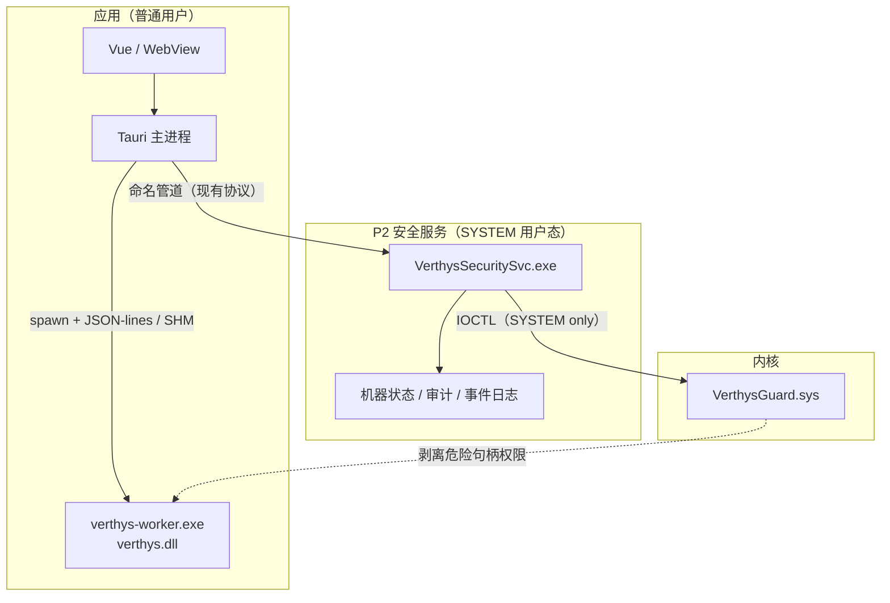
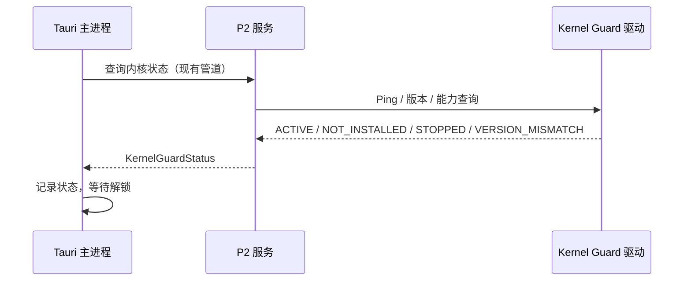
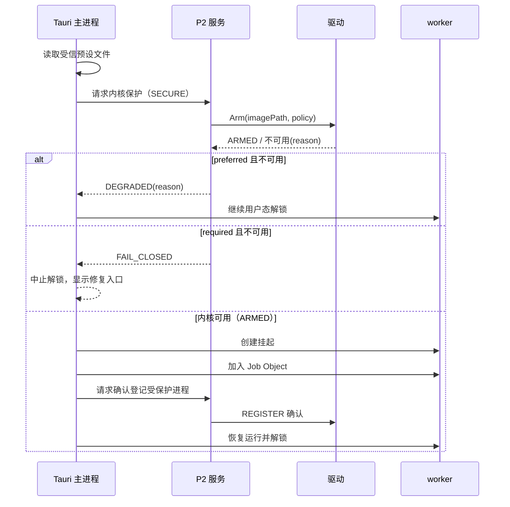
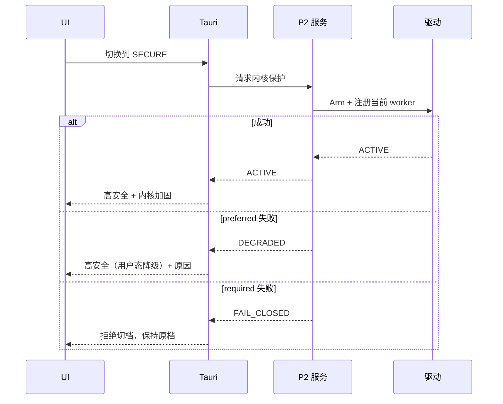

# 02 总体架构

| 项目 | 内容 |
| --- | --- |
| 状态 | 评审稿 |
| 范围 | Kernel Guard L1 组件、信任边界、生命周期与失败语义 |
| 关联 | [README.md](README.md)、[01-threat-model.md](01-threat-model.md)、[03-driver-design.md](03-driver-design.md)、[04-service-and-preset.md](04-service-and-preset.md) |

> Last updated: 2026-11-21

---

## 1. 设计原则

1. **驱动是策略执行点，不是数据路径**：不读文件、不碰密钥、不做加解密
2. **只由 SYSTEM 服务访问驱动**：应用不直接打开设备，复用 P2 服务已有的双向认证
3. **可选增强，不是强制依赖**：`SECURE = preferred` 可降级；只有 `required` 才 fail-closed
4.- **保护开始前不产生外部危险句柄**：先 ARM 受保护映像路径；创建挂起 → Job → 确认登记 → 恢复
5. **不改变现有 11 位特性契约**：内核策略与运行状态独立返回
6. **任何失败都朝可见、可恢复、可审计的方向处理**：不允许静默降级或静默继续

---

## 2. 组件



| 组件 | 运行身份 | 职责 | 不做什么 |
| --- | --- | --- | --- |
| Vue / WebView | 当前用户 | 展示状态、触发切档、显示降级原因 | 不直接访问驱动、不决定内核策略 |
| Tauri 主进程 | 当前用户 | 编排解锁、启动 worker、应用预设、转发状态 | 不持有 GMK、不直接访问驱动 |
| `verthys-worker.exe` + `verthys.dll` | 当前用户 | 解锁、密钥派生、加解密、扫描、导入导出 | 不加载驱动、不修改内核策略 |
| `VerthysSecuritySvc.exe` | LocalSystem | 机器级节流、驱动生命周期、健康检查、审计 | 不接触口令/密钥/明文；不执行客户端输入 |
| `VerthysGuard.sys` | 内核 | 注册受保护进程、剥离句柄权限、上报状态 | 不读文件、不解析容器、不持有密钥 |

---

## 3. 信任边界

| 边界 | 跨越内容 | 保护手段 |
| --- | --- | --- |
| WebView → Tauri 主进程 | 命令、路径、预设参数 | 现有 Tauri command 白名单与路径授权 |
| Tauri → worker | 口令、解锁请求、扫描请求、SHM | 子进程管道、Job Object、worker 沙盒 |
| 应用 → P2 服务 | 机器预算请求、内核状态请求 | 命名管道、ECDSA 响应签名、Authenticode 客户端校验 |
| P2 服务 → 驱动 | 注册/注销受保护进程、查询状态 | 设备 ACL 仅 SYSTEM、定长 IOCTL、版本校验 |
| 驱动 → 受保护进程 | 仅句柄权限剥离 | Ob 回调、映像路径 + 创建时间识别 |
| 驱动 → 内核 | 回调注册、进程引用、事件缓冲 | 最小代码、无动态代码、HVCI 兼容 |

---

## 4. 进程与线程模型

- 主进程 `verthys-tauri` 仍是唯一 UI 宿主
- `verthys-worker.exe` 承载 `verthys.dll` 与全部 FFI 调用，密钥与明文驻留在此
- worker 挂入 Job Object，父进程退出即回收
- Kernel Guard 第一版只保护 worker；主进程保护是 K2 可选项
- 驱动不创建用户态进程，不注入线程，不修改目标进程内存
- 服务是唯一驱动客户端；应用与驱动之间不存在直接句柄

参考：[ARCHITECTURE.md](../ARCHITECTURE.md) 第 4 节。

---

## 5. 生命周期

### 5.1 应用启动与驱动就绪



- 服务随系统启动，驱动随服务加载但默认空闲
- 驱动加载失败不影响应用启动；状态按具体原因记录（`NOT_INSTALLED/STOPPED/VERSION_MISMATCH/UNHEALTHY`）
- 驱动未安装时，`SECURE = preferred` 仍可解锁；`required` 不可解锁

### 5.2 解锁前应用预设与内核策略



- 图中未展开 C 预设应用；它仍走现有 worker/C 路径，服务只负责内核请求

- ARM 在 worker 创建前登记受保护映像路径；驱动在进程创建时即标记保护，外部进程从第一刻起无法拿到危险句柄
- 父进程用创建句柄完成 Job 分配后立即关闭；父进程属于信任边界，其创建句柄窗口不计入外部攻击面
- 预设应用仍走现有 fail-closed 路径：读不到受信档位或切档失败会中止解锁
- `preferred` 的降级是显式状态，不是静默继续

### 5.3 运行期切到 SECURE



- 运行期切入只能从此刻起保护；之前已存在的句柄无法追溯撤销
- `required` 策略建议要求先锁定再解锁，确保从解锁第一刻起受保护
- 切档成功后，UI 必须显示“内核保护：已启用/已降级”，不能只显示“高安全”

### 5.4 worker 重启

```text
worker 退出/崩溃
  → 服务收到进程退出通知或宿主重置
  → 驱动释放旧进程引用
  → ARM 仍在位（受保护映像路径已登记）
  → 新 worker 创建挂起
  → 驱动创建通知立即标记保护
  → 加入 Job Object
  → REGISTER 确认身份（PID + 创建时间 + 路径）
  → 恢复运行
```

- 不能只按 PID 注册；PID 复用会把保护错误地施加到其他进程
- 驱动持有进程对象引用，避免进程退出后的悬空引用
- 确认失败时：`preferred` 标记降级并继续；`required` 锁定并拒绝继续；驱动保留创建时标记的保护，状态不升级为 `ACTIVE`

### 5.5 运行中驱动丢失

```text
服务检测到驱动停止/卸载/无响应
  → 状态置 LOST
  → 若当前为 SECURE + 已解锁：
      立即锁定库、销毁 worker
      写审计
       UI 显示“内核保护丢失，已锁定”
  → 若为 preferred 且尚未解锁：
      标记 DEGRADED，继续用户态解锁
```

- 已解锁会话中丢失保护不接受静默降级
- 驱动恢复后不在已解锁会话中自动挂载；下次解锁或用户显式重新检测后再启用

### 5.6 应用退出与卸载

```text
应用退出
  → 锁定库、销毁 worker
  → 服务注销受保护进程
  → 驱动保持加载但空闲（可选）
卸载
  → 停止应用与服务
  → 注销回调、删除设备对象
  → 停止并删除驱动
  → 删除服务、注册表、驱动文件
  → 无残留
```

---

## 6. 状态机

### 6.1 策略状态

| 策略 | 含义 | 不可用时 |
| --- | --- | --- |
| `off` | 不请求内核 | 不检测 |
| `preferred` | 优先内核 | 降级 `SECURE` 用户态，状态 `DEGRADED`，UI + 审计 |
| `required` | 内核必需 | 拒绝解锁/切档，状态 `FAIL_CLOSED` |

- `BALANCED`、`PERFORMANCE`：`off`
- `SECURE`：默认 `preferred`，高级选项可切 `required`
- `CUSTOM`：可选 `off/preferred`；`required` 在 K2 开放，作为高级配置
- 不新增第四个预设，不新增第 12 个特性位

### 6.2 运行状态

| 状态 | 含义 | 是否可解锁（preferred） | 是否可解锁（required） |
| --- | --- | --- | --- |
| `UNSUPPORTED` | OS/架构不支持 | 是，降级 | 否 |
| `NOT_INSTALLED` | 驱动未安装 | 是，降级 | 否 |
| `STOPPED` | 驱动未运行 | 是，降级 | 否 |
| `VERSION_MISMATCH` | 协议/版本不匹配 | 是，降级 | 否 |
| `UNHEALTHY` | IOCTL 超时/注册失败 | 是，降级 | 否 |
| `ARMED` | 驱动就绪，尚未注册进程 | 是 | 否（需 ACTIVE） |
| `ACTIVE` | 保护已生效 | 是 | 是 |
| `DEGRADED` | 策略要求但只能用户态 | 是 | 否 |
| `LOST` | 运行中丢失 | 锁定 | 锁定 |

状态与原因码必须进入 UI、审计和事件日志，不能只返回一个布尔值。

---

## 7. 数据流

| 方向 | 内容 | 是否允许 |
| --- | --- | --- |
| 应用 → 服务 | 解锁/切档/状态查询 | 允许，现有管道协议 |
| 服务 → 驱动 | 受保护映像路径、创建时间、策略、查询 | 允许，定长 IOCTL |
| 驱动 → 服务 | 状态、原因码、统计、受保护进程事件 | 允许 |
| 驱动 → 应用 | 无直接通道 | 禁止 |
| 应用 → 驱动 | 无直接通道 | 禁止 |
| 驱动 → 文件/密钥/明文 | 不读取、不写入、不持有 | 禁止 |
| 服务 → 文件/密钥/明文 | 不读取、不写入、不持有 | 禁止（与 P2 非目标一致） |

---

## 8. 失败语义

| 场景 | `preferred` | `required` |
| --- | --- | --- |
| 驱动未安装 | 降级，继续解锁 | 中止解锁 |
| 驱动停止 | 降级，继续解锁 | 中止解锁 |
| 版本不匹配 | 降级，继续解锁 | 中止解锁 |
| 注册受保护进程失败 | 降级，继续解锁 | 中止解锁/锁定 |
| 运行中丢失 | 立即锁定 | 立即锁定 |
| 服务不可用 | P2 本身 fail-closed | P2 本身 fail-closed |
| 预设文件读取失败 | 现有 fail-closed | 现有 fail-closed |
| 驱动恢复可用 | 下次解锁或显式重检后启用 | 下次解锁后启用 |

---

## 9. 安全与可维护性约束

- 驱动不加载用户路径 DLL，不使用动态代码，不使用可写可执行内存
- 驱动只使用文档化内核 API；不使用未文档化结构、SSDT/IDT Hook
- 设备 ACL 仅 SYSTEM；应用不直连
- 驱动与服务版本必须匹配；不匹配按失败语义处理
- 驱动代码遵循最小权限、最小公开面、显式失败、可卸载
- 所有状态变化写审计；审计不包含密钥、口令、完整用户路径
- 驱动加载即注册 Ob 回调；未 ARM 时回调直接放行，不匹配、不剥离任何进程
- SECURE 只控制 ARM/受保护进程登记，不反复注册/注销回调
- 驱动不自我防护、不参与反卸载军备竞赛；卸载由服务控制

---

## 10. 与现有预设契约的关系

- 现有 11 位契约仍由 C 运行时策略层投影，`SECURE = 0x7FF`
- 内核策略是独立字段，不进入 `security_preset_feature_bits`
- UI 的 11 个防护点保持不变；新增“内核加固”独立区域
- `app_feature_gate` 的保守全开语义不变；内核状态独立存储
- 解锁前预设应用仍走 [preset.rs](../../verthys-tauri/src-tauri/src/security_commands/commands/preset.rs) 的 fail-closed 路径

---

## 11. 待决问题

1. 驱动是否随 perMachine 安装包默认安装，还是仅在用户选择 SECURE 时安装
2. `required` 是否作为 SECURE 的高级开关，还是等 K2 后单独评估
3. `preset.json` 的策略权威是否迁移到 P2 服务；若不迁移，`required` 的防降级能力不足
4. 主进程保护是否在 K2 默认开启，还是仅在高安全 + 文件保护场景开启
5. 驱动升级是否需要强制重启；被占用时的替换策略

以上问题在 K0 审核中定稿，未定稿前不进入 K1 编码。
