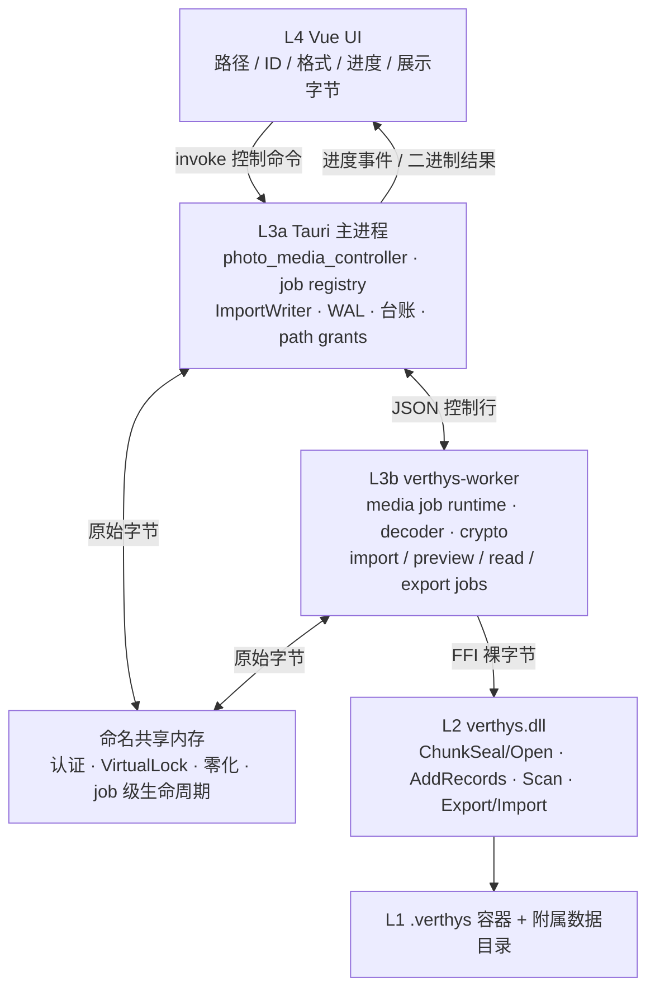
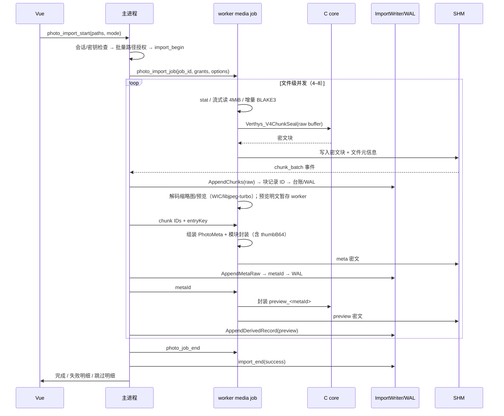
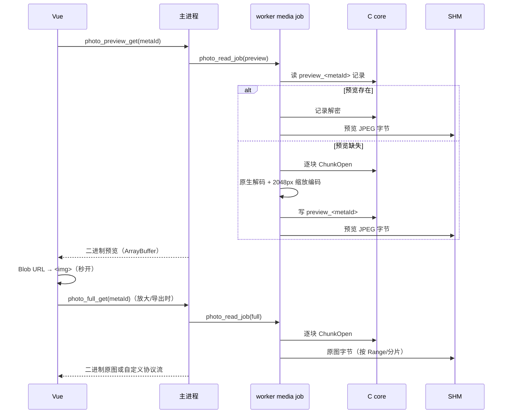
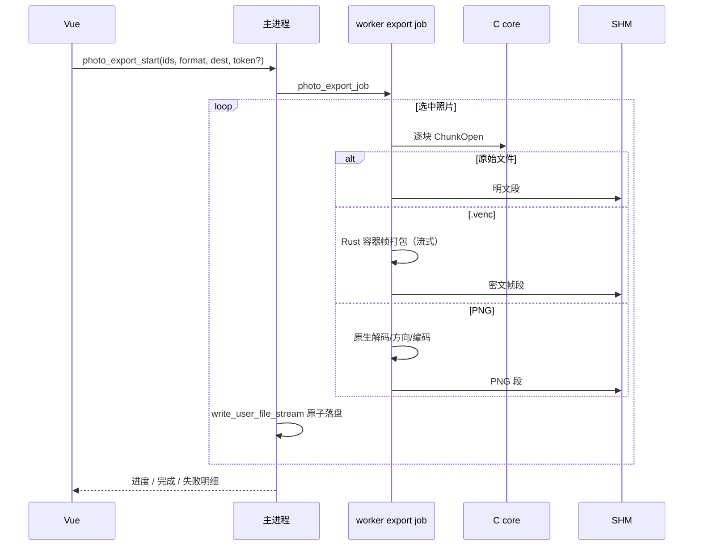

# 01 — 目标架构

> 状态：评审中 · 最后更新：2026-11-18 · 维护人：K1Super
>
> 本文定义照片数据面的目标进程/线程模型、数据流、模块边界与安全不变量。所有实现必须以此为准。

---

## 1. 现状核验

### 1.1 现有分层

- L4：Vue/WebView，当前实际持有照片明文、base64 密文与解密调度。
- L3：Tauri 主进程（导入单写者、WAL/台账、命令层）+ `verthys-worker` 子进程（C 句柄、密钥、扫描 SHM）。
- L2：`verthys.dll`，提供裸字节的块加解密、记录读写、扫描与容器事务。
- L1：`.verthys` 容器与附属数据目录。

现有结构本身没有问题；问题在于**照片字节流被放在 L4**，而 C 层已经具备裸字节能力。

### 1.2 关键瓶颈（代码级证据）

| 位置 | 行为 | 影响 |
|---|---|---|
| `photo-crypto.worker.ts` | 逐 1MiB `await workerRpc.request({op:"seal"})` | 单张照片块级串行；旧 1MiB 块下 10MiB=10 次、24.43MiB≈25 次、100MiB=100 次往返 |
| `module_crypto.ts` / `worker-rpc.ts` | 每次记录加解密传 base64 + JSON | 33% 膨胀；编码/解码/JSON 解析占用主线程与 worker |
| `importPipeline.ts` / `usePhotoImport.ts` | 整文件读入 JS，再 transfer 到 Worker | 大文件内存峰值与复制成本；无法流式 |
| `photoWorkerPool.ts` | 主线程保留 source 权威副本，每次投递 `source.slice()` | 照片至少两份同阶字节常驻（10MiB 样本约 20MiB；大图按比例放大） |
| `photo-crypto.worker.ts` | 缩略图 `createImageBitmap(blob)` 全分辨率解码 | 24MP 照片解码约 100MB RGBA；高像素照片导入被解码拖慢 |
| `chunk-refs.ts` | 一次取全部块密文到主线程 | 大照片形成 base64 字符串风暴与 N 次 IPC |
| `processDecryptChunks` | 逐块串行 `open` RPC | 查看端与导入端对称的串行往返 |
| `usePhotoViewer.ts` | 解密后整图 Blob + 全分辨率 `` | 首屏等待全图解密与全图解码；无预览、无缓存 |

### 1.3 结论

必须把照片字节流从 L4 移出，且不能只把 base64 换成二进制后仍留在 JS。目标是把**文件 I/O、解码、加密、记录写入、导出**全部收敛到 Rust/C。

## 2. 目标进程与数据面

### 2.1 进程/模块图



### 2.2 职责边界

| 层 | 负责 | 不负责 |
|---|---|---|
| L4 Vue | 选路径、展示进度、预览/原图渲染、导出参数 | 不读文件字节、不做哈希/加密/解码、不持有密钥 |
| L3a 主进程 | 命令编排、job 注册、路径授权、导入会话、WAL/台账、单写者、进度转发、原子落盘、写密文记录、转发展示缩略图/预览/导出字节 | 不做照片解码、不做块/meta 加解密、不持有密钥 |
| L3b worker | 流式读盘、BLAKE3、缩略图/预览解码编码、块 seal/open、记录读取与封装、原生导出/备份解析、SHM 生产消费 | 不决定 UI、不持有会话策略、不直接暴露原图明文到 L4；记录写入由主进程单写者发起 |
| L2 C DLL | 容器事务、块 AEAD、记录 AEAD、扫描、完整性 | 不做文件调度与 UI |

### 2.3 关键数据面原则

1. 照片原始字节不进入 JSON、不进入 base64、不进入 Web Worker。
2. 控制面（命令、job 状态、进度、错误）走现有加密 JSON 行。
3. 大载荷（密文块、预览、原图、导出段）只走 SHM 或 Tauri 二进制响应。
4. 照片原图的存储明文、全分辨率解码中间产物与加密缓冲只允许出现在 worker 与 job SHM；展示用缩略图/预览与最终导出字节属于输出，可按输出路径离开 worker。
5. 主进程不接触原图的解码/加密中间明文；只接触路径、密文、记录 ID、展示缩略图/预览字节与最终导出字节。

## 3. 核心数据流

### 3.1 批量导入



要点：

- worker 负责“读、算、加密、解码”；主进程负责“会话、授权、单写者、WAL、台账”。
- 序列中的 preview 步骤默认由后台 preview 队列执行（低优先级 1–2 并发），不阻塞导入完成；`previewMode=inline` 时才随文件执行；查看缺失时懒生成。
- 密文块会经 worker → SHM → 主进程 → worker `add_chunk_batch_raw` 写入；这是可接受的密文级复制，换取单写者与现有 WAL/台账零改动。
- 源文件删除只在 import_end 成功且台账落盘成功后执行（`mode=move`）。

### 3.2 查看



- 预览是首屏唯一必需数据；原图只在用户放大超过阈值、导出或动画播放时读取。
- 旧照片没有预览记录时，`photo_preview_get` 触发一次懒生成并落库，后续秒开。
- 预览按 `preview_<metaId>` 确定性命名；worker 维护会话级 `metaId → previewId` 索引，导入时登记，重启后按预览类型索引重建；不重写旧 meta。
- 前端保留有界 Blob URL LRU；锁/登出/卸载时统一释放。

### 3.3 导出与备份还原



- 导出文件写入仍复用主进程现有原子写协议（临时文件 → fsync → rename / abort 清理）。
- `.venc` 打包与解析从 JS 下沉到 Rust；格式与字段保持兼容。
- 备份还原在 worker 内解析容器、解密、重新封装，再走同一导入写入链。

## 4. Worker 媒体任务运行时

### 4.1 为什么需要独立 job runtime

现有 worker 主循环是单线程：stdin 行 → dispatch → FFI。大文件导入/导出/解码不能阻塞主循环，否则控制命令、取消、锁请求全部排队。

目标形态：

- worker 主循环继续负责控制行、job 注册、进度转发。
- 新增 `media_job_runtime`：
  - 文件 I/O / 解码线程池（2–8，按 CPU/内存预算与文件级并发 4–8 配置）；
  - 加密/记录 FFI 调用采用单线程串行或受控并发（取决于 Gate G0 的线程安全结论）；
  - 所有输出经有界 channel 回到主循环，由主循环写 stdout/进度通道；
  - 媒体 job 线程优先级按交互性设置（导入/预览/导出可高于 worker 主循环的 BELOW_NORMAL，但不得抢占 UI 前台；G0 验证）。
- 每个 job 有 `job_id`、`AtomicBool cancel`、阶段状态、字节计数、错误收集器。
- 同一时刻限制活跃 job 数（默认 1 个照片 job + 1 个预览/导出 job），避免磁盘与 C 句柄争用。

### 4.2 长任务协议

```text
photo_job_begin   → { job_id, kind, options }
photo_job_progress← { job_id, stage, file_index, files, bytes, total_bytes, elapsed_ms }
photo_job_cancel  → { job_id }
photo_job_end     ← { job_id, ok, summary, failures[] }
```

约束：

- `begin` 必须快速返回，不等待任务完成。
- 普通 IPC 的 15s 超时不适用于 job；改用阶段心跳 + 主进程 watchdog。
- 取消在块边界/文件边界生效；已提交块保留，WAL 不压缩，可续传。
- 锁定/退出必须先取消并等待媒体 job 归零，沿用全库轮换的 `session_epoch` 闸门语义。

## 5. 共享内存数据面

### 5.1 设计

- 复用现有扫描 SHM 的认证、随机命名、`VirtualLock`、销毁模式，抽象为 `media_shm`。
- 每个 job 一条双向缓冲或两条单向缓冲：
  - `control`：小结构（offset/length/seq/flags）；
  - `data`：原始字节区，默认 8MiB（覆盖 4MiB 块 + 预览 + 头部余量）。
- SHM 头包含：magic、version、job_id、方向、seq、payload_len、CRC/HMAC、状态位。
- 生产者写完置 ready；消费者读完后置 consumed；双方按 seq 严格递增。
- job 结束/取消/超时：零化并销毁映射；不得留下明文页。

### 5.2 禁止项

- 禁止在 JSON `data` 字段传照片字节。
- 禁止把 SHM 名称、路径、明文写入日志。
- 禁止跨 job 复用同一 SHM 而不重新认证。

## 6. 并发与背压

| 维度 | 默认 | 说明 |
|---|---|---|
| 文件级并发 | 4–8 | 磁盘顺序吞吐与小文件合并 |
| 单文件块并发 | 1–2 | 受 C 线程安全与内存预算约束；4MiB 块已显著减少块数 |
| 全局字节预算 | 256MiB | 读缓冲 + 解码位图 + 密文块 + SHM 在途 |
| ImportWriter 批量 | 128–512 条/事务，且单批密文 ≤64MiB | `Verthys_AddRecords` 上限 512；按字节二次裁剪，减少 fsync 且不超内存预算 |
| 进度频率 | 10Hz | 合并事件，避免 IPC 洪泛 |
| 预览并发 | 2 | 用户快速翻看时的有界预取 |

背压规则：

- SHM 未消费时生产者等待，不无限堆积。
- ImportWriter 通道满时 worker 暂停投递，不丢块。
- 解码位图超过预算时降低并发或拒绝超大像素图片（解压炸弹防护）。

## 7. 安全不变量

1. 密钥只存在于 worker 与 C 会话；主进程与前端不接触密钥。
2. 导入的原图明文只在 worker 内；主进程只接收密文块；展示用缩略图/预览按输出路径下发。
3. 查看/导出的明文只经 SHM 到主进程的展示/写盘路径；不落临时明文文件。
4. 路径必须由主进程签发批量/作业级 grant；worker 只消费未过期、未使用、操作/模式匹配的 grant。
5. SHM 必须认证；未认证/被篡改/跨 job 重放一律失败关闭。
6. 解码器必须限制像素总量、尺寸、内存与超时；不可信图片不得导致 OOM。
7. 锁定、登出、worker 销毁必须取消媒体 job 并释放 SHM/缓存；延迟结果不得写入新会话。
8. 日志不得包含路径、文件名、明文或密钥；错误对外只返回分类与 job_id。

## 8. 失败模型

| 失败 | 行为 |
|---|---|
| 源文件读失败 | 该文件失败入账；已提交块保留；不删除源文件 |
| 源文件导入中被修改 | 读写前后 `(size, mtime)` 校验；变化即该文件失败 |
| 容器容量不足 | 会话终止，不可重试失败入账；保留 WAL，提示释放空间 |
| worker 崩溃 | 主进程标记 job 失败；WAL 保留；重启后续传；已提交块由台账结算 |
| 取消 | 块/文件边界停止；已提交块保留；import_end(false) 不压缩 WAL |
| 预览生成失败 | 导入不失败；查看回退原图；下次再试 |
| 预览记录损坏 | 视为缺失，重新生成；不阻断原图 |
| SHM 超时/校验失败 | 失败关闭；终止该 job；记录结构化错误 |
| 锁定/退出 | 先取消 job 并等待归零；超时则 fail-closed |

### 8.1 错误分类

| 分类 | 场景 | 前端动作 |
|---|---|---|
| `PATH_UNAUTHORIZED` | grant 缺失/过期/跨 job/越权 | 终止该文件/job；不重试 |
| `SOURCE_CHANGED` | 导入中 size/mtime 变化 | 该文件失败；源文件保留 |
| `FILE_TOO_LARGE` | 超过单文件上限 | 跳过并提示 |
| `DECODE_UNSUPPORTED` | 解码器不支持/损坏 | 照片可导入；缩略图/预览缺失 |
| `SHM_AUTH` | SHM 校验/重放/超时 | 失败关闭；终止 job |
| `JOB_CANCELED` | 用户取消 | 停止投递；保留 WAL |
| `STORAGE_FULL` | 容器/磁盘容量不足 | 终止；提示清理；保留 WAL |
| `SESSION_LOCKED` | 锁/登出/代际变化 | 拒绝并清理 job |
| `PREVIEW_MISSING` | 预览缺失/损坏/头不匹配 | 回退原图或懒生成 |
| `EXPORT_FORMAT` | 格式/动图 PNG 不支持 | 按张失败并提示 |

错误只返回分类、job_id 与必要计数；不暴露路径、明文、密钥或内部堆栈。

## 9. 被否方案

| 方案 | 否决原因 |
|---|---|
| 只在 JS 层把串行改并发 | 仍是 base64/JSON/Worker 数据面；无法解决全图解码与内存复制 |
| 主进程直接读文件、worker 只加密 | 导入源文件明文进入主进程；与“原图明文只留 worker”目标冲突 |
| 把 WAL/台账整体迁入 worker | 高风险重构；会破坏现有单写者与 FileVerthys 共用通道；本方案改为 worker 产密文、主进程写 |
| 明文临时文件 + asset 协议查看 | 违反“明文不落盘” |
| 直接把所有块搬进共享内存 | 大文件仍是一次性载荷；必须分片/流式 |
| 内容哈希去重替代 entry_key | 改变现有续传/删除释放语义；需单独产品决策 |

## 10. 架构决策记录（ADR）

- **ADR-01 数据面下沉 Rust**：照片字节不再经过 JS。
- **ADR-02 worker 产密文、主进程写**：原图明文/密钥留 worker（展示/导出输出除外）；单写者/WAL/台账留主进程。
- **ADR-03 SHM 数据面**：JSON 只做控制；原始字节走认证共享内存。
- **ADR-04 4MiB 分块**：新导入块数下降 3–4 倍；旧 1MiB 兼容。
- **ADR-05 预览优先**：2048px 预览独立记录；原图按需。
- **ADR-06 确定性预览名**：`preview_<metaId>`；旧照片懒生成，不重写 meta。
- **ADR-07 原生解码**：WIC + libjpeg-turbo 缩放解码；WebP/GIF 兼容解码。
- **ADR-08 VENC 不变**：清单字段不扩展；预览不入备份。
- **ADR-09 去重语义不变**：entry_key 续传幂等；内容去重另议。
- **ADR-10 长任务协议**：job_id + 进度 + 取消 + 心跳。
- **ADR-11 批量路径授权**：作业级 grant，突破单路径 32 条/TTL 限制。
- **ADR-12 旧 JS 管线仅浏览器回退**：桌面端验收后删除。
- **ADR-13 C 批量提交/回退锚点摊销**：G0 实测每次 `AddRecords/Flush` 固定约 450ms，根因是 TPM 回退见证轮换；导入必须批量提交并按会话/批次推进锚点，需安全评审与崩溃/断电测试。未通过前不承诺 250ms 导入目标。
